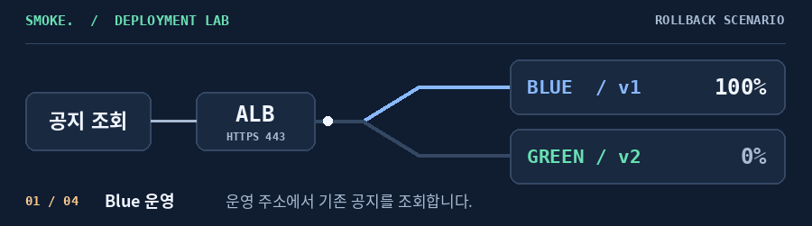

<div align="center">

# ㈜스모크 | 공지·자료실 인프라 전환

**온프레미스 보안 인프라 재구축 및 AWS 마이그레이션을 통한 무중단 배포·장애 대응 체계 구축**

KDT 최종 프로젝트　·　스모커 팀 4인　·　2026.11.21 – 12.09

[](https://github.com/CHANYOUNGKANG/Final_4gl_team_smoke/actions/workflows/project-progress.yml)
[](https://github.com/CHANYOUNGKANG/Final_4gl_team_smoke/commits/main)
[](https://github.com/CHANYOUNGKANG/Final_4gl_team_smoke/issues)
[](https://github.com/CHANYOUNGKANG/Final_4gl_team_smoke/pulls)

[](docs/delivery/README.md#첫날-작업표) [](https://github.com/CHANYOUNGKANG/Final_4gl_team_smoke/issues/new?template=team-task.yml) [](docs/delivery/README.md#결과-기록표)

</div>

## 지금 우리 팀

> 아래 두 패널과 활동 표는 **main에 push할 때마다, 그리고 매일 00:05(KST)** GitHub Actions가 다시 그린다. 손으로 고치지 않는다.

[](docs/progress/README.md)

[](docs/delivery/README.md#수행계획서-일정--2026년)

<!-- smoke-activity:start -->
| 최근 커밋 | 작성자 | 시각 (KST) |
| --- | --- | ---: |
| [`5756a52`](https://github.com/CHANYOUNGKANG/Final_4gl_team_smoke/commit/5756a5291dfc280f878f539b2a7a5b842afd94fc) chore: 보안 자동 검사와 AI 작업 규칙 추가 (#2) | CHANYOUNGKANG | 11/25 21:44 |
| [`d7852e5`](https://github.com/CHANYOUNGKANG/Final_4gl_team_smoke/commit/d7852e5597d8909b5334e815f8bf57fd2897b47f) docs: add team security rules for public project materials | CHANYOUNGKANG | 11/25 21:12 |
| [`628b270`](https://github.com/CHANYOUNGKANG/Final_4gl_team_smoke/commit/628b270eee0dca78c6609a6ef4cb92c55333e1fd) fix: 최근 활동 시각을 KST 절대 시각으로 표기 | claude | 11/25 21:01 |

**열린 이슈·PR**　[#1 팀 구축 진행률 · 구현 근거와 시연 기록](https://github.com/CHANYOUNGKANG/Final_4gl_team_smoke/issues/1)

**작업 브랜치 7개**　[`aws/woobin-day1-jenkins-ec2`](https://github.com/CHANYOUNGKANG/Final_4gl_team_smoke/tree/aws/woobin-day1-jenkins-ec2)　[`chore/security-automation`](https://github.com/CHANYOUNGKANG/Final_4gl_team_smoke/tree/chore/security-automation)　[`cicd/chanyoung-day1-first-build`](https://github.com/CHANYOUNGKANG/Final_4gl_team_smoke/tree/cicd/chanyoung-day1-first-build)　[`cicd/worklog-jenkins-bootstrap`](https://github.com/CHANYOUNGKANG/Final_4gl_team_smoke/tree/cicd/worklog-jenkins-bootstrap)　[`docs/ip-plan`](https://github.com/CHANYOUNGKANG/Final_4gl_team_smoke/tree/docs/ip-plan)　[`network/minseo-day1-topology`](https://github.com/CHANYOUNGKANG/Final_4gl_team_smoke/tree/network/minseo-day1-topology)　[`server/junho-day1-app-handoff`](https://github.com/CHANYOUNGKANG/Final_4gl_team_smoke/tree/server/junho-day1-app-handoff)

<sub>11/25 21:44 KST 기준 · main push와 매일 00:05에 갱신</sub>
<!-- smoke-activity:end -->

<details>
<summary><b>점수표 텍스트로 보기</b> · 산정 기준과 근거 파일</summary>

<!-- smoke-progress:start -->
**전체 구축 진행률 0.0%**　·　0/32점

| 파트 | 점수 | 진행률 |
| --- | ---: | ---: |
| 강민서 · 네트워크 | 0/8 | 0.0% |
| 이준호 · 서버 | 0/8 | 0.0% |
| 이우빈 · AWS | 0/8 | 0.0% |
| 강찬영 · CI/CD | 0/8 | 0.0% |
<!-- smoke-progress:end -->

파트마다 이정표 4개, 이정표별로 **구현 근거 1점 + 실행 근거 1점**. 업무 브랜치를 push하면 Actions 실행 요약에 그 브랜치 점수가 나오고, main 점수는 위 패널과 [이슈 #1](https://github.com/CHANYOUNGKANG/Final_4gl_team_smoke/issues/1)에 모인다. [산정 기준](docs/progress/README.md) · [브랜치별 기록](https://github.com/CHANYOUNGKANG/Final_4gl_team_smoke/actions/workflows/project-progress.yml)

</details>

## 작업 시작하기

| 순서 | 할 일 | 바로가기 |
| :---: | --- | --- |
| 0 | 보안 규칙과 AI 도구 작업 규칙 확인 | [팀 보안 규칙](#팀-보안-규칙) · [AGENTS.md](AGENTS.md) · [SECURITY.md](SECURITY.md) |
| 1 | 오늘 내 작업과 다음 파트에 넘길 결과 확인 | [첫날 작업표](docs/delivery/README.md#첫날-작업표) · [일일 기록](docs/daily/) · 파트별 `WORKLOG.md` |
| 2 | 작업 이슈 열기 (파트·요구사항·이정표 선택) | [작업](https://github.com/CHANYOUNGKANG/Final_4gl_team_smoke/issues/new?template=team-task.yml) · [인계 요청](https://github.com/CHANYOUNGKANG/Final_4gl_team_smoke/issues/new?template=handoff.yml) · [막힘·장애](https://github.com/CHANYOUNGKANG/Final_4gl_team_smoke/issues/new?template=blocker.yml) |
| 3 | 브랜치를 만들고 내 파트 폴더에서 작업 | 아래 명령 · [작업 양식](docs/templates/) |
| 4 | PR에 이슈 번호와 확인 결과를 적고 main에 병합 | [PR 체크리스트](.github/PULL_REQUEST_TEMPLATE.md) |
| 5 | 실행 결과를 `evidence.json`에 등록하면 점수 +1 | [등록 방법](docs/progress/README.md#실행-근거를-올리는-방법) · [측정 기록 이슈](https://github.com/CHANYOUNGKANG/Final_4gl_team_smoke/issues/new?template=demo-result.yml) |

```bash
git clone https://github.com/CHANYOUNGKANG/Final_4gl_team_smoke.git && cd Final_4gl_team_smoke
git switch -c cicd/first-war-build          # <파트>/<작업이름>: network·server·aws·cicd
git add cicd/ && git commit -m "cicd: first WAR build"
git push -u origin cicd/first-war-build     # push하면 Actions가 이 브랜치 점수를 계산
```

**일정**　11/26 첫 WAR 빌드 → 12/5 AWS·배포 연동 → 12/7 통합 검증 → 12/9 최종 보고서·발표. [전체 일정과 인계표](docs/delivery/README.md)

## 팀 보안 규칙

이 공개 저장소에 작업하는 팀원과 AI 도구는 코드 작성, 작업일지 정리, 캡처·PPT 제작을 시작하기 전에 이 규칙을 읽고 적용한다. 새 ChatGPT·Claude 세션에서도 저장소의 최신 README를 먼저 확인한다. 개인 작업 브랜치, 커밋, PR·이슈와 댓글, Actions 로그·아티팩트, 시연 자료에도 같은 기준을 적용한다.

### 자격 증명과 환경값

| 범위 | 저장소에 올리기 전 기본 처리 |
| --- | --- |
| **AWS** | AWS Access Key ID, Secret Access Key, STS 세션 토큰, AWS 자격 증명 파일은 커밋·출력 금지. EC2의 Jenkins는 필요한 권한만 부여한 IAM 역할을 사용하고 GitHub Actions에서 AWS에 접근할 때는 저장소와 브랜치 또는 환경으로 신뢰 범위를 제한한 OIDC 역할을 사용한다. 장기 키가 불가피하면 담당자가 승인된 비밀 저장소에서 관리한다. [AWS 액세스 키 지침](https://docs.aws.amazon.com/IAM/latest/UserGuide/securing-access-keys.html) |
| **CI/CD·컨테이너** | SSH 개인키·PEM, GitHub PAT, Jenkins API 토큰, 웹훅 공유 비밀, 레지스트리 토큰, kubeconfig와 Kubernetes Secret 원본을 제외한다. Jenkins Credentials·GitHub Actions Secrets·승인된 비밀 저장소에서 실행 시 주입하고 Jenkinsfile·워크플로에는 자격 증명 ID와 변수명만 적는다. Docker 이미지, 빌드 인자, 로그에 비밀값을 남기지 않는다. |
| **서버·DB·메일** | Linux·Tomcat·MariaDB·RDS·Redis·SMTP 및 메일 계정의 인증 정보와 TLS 개인키는 비밀 저장소에서 관리한다. 실제 DB 덤프, 운영 메일 원문, 사용자 파일은 공개하지 않는다. 재현에는 샘플 데이터와 마스킹한 결과를 사용한다. |
| **네트워크·보안** | IPsec PSK, 장비 로그인·enable 비밀번호, SNMP 커뮤니티 문자열, 원본 장비 설정·패킷 캡처·보안 로그의 민감값을 제외한다. 공개 구성도와 증빙은 예시 주소를 쓰고 VLAN·ACL·라우팅은 필요한 설명과 검증 결과만 남긴다. |
| **환경별 설정** | 관리용 IP·호스트명·포트, DB 엔드포인트, AWS 계정·리소스 식별자는 환경 설정으로 분리하고 공개 자료에는 승인된 서비스 주소 또는 예시값을 사용한다. 코드는 `DEPLOY_HOST`, `DEPLOY_PORT`, `DB_HOST` 등으로 값을 받는다. `.env.example`에는 가짜 값만 두고 실제 `.env`와 로컬 인증 파일은 버전 관리에서 제외한다. |

관리 접속은 승인된 관리망이나 Bastion 경로를 쓰고, 방화벽 ACL·AWS 보안 그룹·IAM은 필요한 출발지와 권한만 허용한다. Jenkins 관리 화면, SSH, DB 관리 포트의 인터넷 전체 허용은 금지한다.

### 작업일지·캡처·PPT 게시 전

1. **코드와 설정에서 먼저 치환한다.** 실제 비밀값이 포함된 입력을 받으면 코드·명령 예시·일지에 복사하지 않고 자격 증명 참조나 변수명으로 바꾼다. 환경 변수로 주입한 비밀값도 셸 추적과 디버그 출력에서 제외한다.
2. **증빙을 확인한다.** 터미널·Jenkins 콘솔·AWS 콘솔·주소창·QR 코드에 표시된 토큰, 관리 주소, 계정 정보, 개인정보를 확인한다. 원본과 별도로 잘라내거나 해당 영역을 불투명하게 가린 사본을 만들고, 내보낸 PNG·PDF·PPT를 다시 열어 확인한다. PPT의 원본 이미지, 발표자 노트, 숨은 슬라이드에도 민감값을 남기지 않는다.
3. **커밋·푸시 전에 확인한다.** 스테이징된 파일 목록과 diff를 확인하고 이미지·문서·압축파일은 실제 내용도 확인한다. 사용 가능한 비밀값 검사나 GitHub 푸시 보호 경고가 있으면 원인을 확인하고, 민감값이 남은 파일은 수정한 뒤 게시한다. 일지와 PR에는 검증 결과와 마스킹한 증빙만 링크한다.

### 자동 검사

모든 push·PR에서 **gitleaks**가 비밀값을 검사하고, PR에서는 워크플로·Dockerfile·Kubernetes 매니페스트 형식과 코드 속 IP 주소를 확인한다. 로컬에서는 `pip install pre-commit && pre-commit install` 후 커밋할 때마다 같은 검사가 돈다. 세부 절차는 [SECURITY.md](SECURITY.md).

### 민감값이 공개된 경우

팀과 해당 계정 담당자에게 즉시 알리고 노출된 키·토큰·비밀번호를 폐기·교체한다. SSH 키라면 서버의 기존 공개키 등록도 제거한다. AWS 키는 사용 중지 후 CloudTrail과 비용·리소스 변경을 확인하고, 필요하면 해당 자격 증명으로 발급된 세션도 차단한다. 이어서 공개 파일·PR·로그·아티팩트와 영향을 받은 Git 이력을 확인해 담당자와 정리한다. 노출 신고나 이슈에는 비밀값 원문을 붙이지 않는다. [AWS 자격 증명 노출 대응](https://aws.amazon.com/blogs/security/what-to-do-if-you-inadvertently-expose-an-aws-access-key/)

## 팀 워크스페이스

담당자 카드를 누르면 파트별 체크리스트가 열린다. 공지 웹앱을 넘기거나 빌드할 때는 [공용 앱 폴더](app/)의 인계표를 본다.

| 온프레미스 | AWS · 배포 |
| :---: | :---: |
| [](network/)<br>✉  [ehdanfqnd@naver.com](mailto:ehdanfqnd@naver.com) | [](aws/)<br>✉  [woobin6318@gmail.com](mailto:woobin6318@gmail.com) |
| [](server/)<br>✉  [dlwnsgh7789@gmail.com](mailto:dlwnsgh7789@gmail.com) | [](cicd/)<br>✉  [chanyoungcplus@gmail.com](mailto:chanyoungcplus@gmail.com) |

## 프로젝트 소개

직원이 공지를 올리고 외부 사용자가 첨부파일을 내려받는 동안, 본사 서버 한 대가 사내 업무와 외부 서비스를 모두 처리한다. 웹 서버에 비정상 접근 흔적이 남아도 로그가 흩어져 경로를 추적하기 어렵고, 새 버전을 배포하려고 Tomcat을 재시작하면 읽던 공지도 끊긴다.

스모커 팀은 **사내망을 접근 목적별로 분리하고, 외부 공지·자료실을 AWS 두 가용 영역으로 이전**한다. 고객이 계속 쓰던 글과 파일을 보존하고, 배포 중에도 같은 주소에서 공지를 읽을 수 있게 하는 것이 목표다.

## 배포 흐름 미리보기

[](https://smoke-release-lab.chanyoungcplus.chatgpt.site)

**[▶ 브라우저에서 시뮬레이터 열기](https://smoke-release-lab.chanyoungcplus.chatgpt.site)** · [오프라인 버전 다운로드 (.zip)](https://github.com/CHANYOUNGKANG/Final_4gl_team_smoke/raw/refs/heads/main/docs/demo/smoke-demo.zip) · [소스 보기](docs/demo/index.html) · [원본 설계 화면](docs/images/blue-green.png)

시뮬레이터에서 시나리오를 고른다. 인터넷 연결이 없는 발표장에서는 오프라인 버전의 `index.html`을 연다. 발표 때는 **한 단계 진행**으로 멈춰 설명하거나 재생 속도를 바꿀 수 있다. 애니메이션은 배포 설계를 설명한다. 실제 측정값은 [시연 기록표](docs/delivery/README.md#결과-기록표)에 남긴다.

| 선택 | 검사 결과 | 사용자가 접속하는 버전 |
| --- | --- | --- |
| 정상 배포 | Green에서 공지 작성·조회 성공, 전환 후 운영 주소에서도 확인 | Blue → Green |
| 전환 전 검증 실패 | Green 전용 경로에서 공지 조회 실패, Jenkins가 전환 차단 | 처음부터 끝까지 Blue |
| 전환 후 자동 롤백 | 운영 주소에서 오류 감지, 이전 대상 그룹 복귀 후 재검사 | Blue → Green → Blue |

## 시스템 아키텍처

[](docs/architecture/README.md)

| 경로 | 서비스가 동작하는 방식 |
| --- | --- |
| **공지 조회** | HTTPS 요청은 ALB를 거쳐 운영 중인 EKS 버전으로 들어간다. 첨부파일은 CloudFront가 비공개 S3에서 가져와 제공한다. |
| **데이터 이관** | MariaDB 게시글은 RDS로, 첨부파일은 S3로 옮긴다. 전후 게시글 건수·대표 본문·파일 해시를 원본과 대조한다. |
| **배포와 복귀** | Jenkins가 테스트와 WAR 빌드를 실행한다. 커밋 태그를 붙인 Docker 이미지를 ECR에 올린 뒤 Ansible로 Green에 배포하고, 공지 작성·조회에 성공하면 ALB를 전환한다. |
| **운영 알림** | Snort 탐지, 백업 결과, CloudWatch 장애 경보, Jenkins 배포 결과를 운영 메일함에서 확인한다. |

## 기술 스택과 파트 간 인계

| 파트 | 주요 기술 | 다음 파트에 전달할 것 |
| --- | --- | --- |
| 네트워크·보안 | GNS3, Cisco ASA, pfSense, VLAN, IPsec, Snort | 서버망 위치, 허용 경로, 허용·차단 및 탐지 기록 |
| 서버·메일 | Rocky Linux, Nginx, Tomcat, MariaDB, Ansible, Postfix, Roundcube | 앱 소스와 빌드 버전, DB 덤프, 첨부 해시 목록, 운영 메일 수신 기록 |
| AWS 클라우드 | VPC, EKS, ALB, RDS, S3, CloudFront, EFS, Redis, CloudWatch | 후보 검증 경로, 대상 그룹, 전환·복귀 방법, 이관 대조 결과 |
| CI/CD | GitHub Webhook, Jenkins, Maven, Docker, ECR, Ansible, Kubernetes | 커밋별 WAR·이미지 식별자, 정상 전환·롤백 로그, 연속 조회 결과 |

## 요구사항과 인수 기준

| ID | 요구사항 | 주 담당 / 협업 | 인수 기준 |
| --- | --- | --- | --- |
| SRS-REQ-01 | 본사·지사 VLAN, 라우팅·게이트웨이 이중화, 방화벽 ACL·NAT·IPsec VPN | 강민서 | 업무망의 관리 포트 접근 차단, 관리망 허용, 회선·장비 장애 후 경로 전환과 통신 복구를 기록한다. |
| SRS-REQ-02 | 두 AZ의 EKS, HTTPS ALB와 전환·복귀, RDS·S3 이관 | 이우빈 / 이준호·강찬영 | 버전별 응답, 워커 교체 시간, 이관 전후 건수·해시와 원본 저장소 외부 직접 접근 차단을 확인한다. |
| SRS-REQ-03 | Git 변경으로 테스트·빌드·ECR 등록, 후보 배포·검증·자동 복귀 | 강찬영 / 이우빈 | 커밋·빌드 로그·이미지 태그를 대조하고 배포 중 실패 수와 롤백 후 이전 버전 응답을 확인한다. |
| SRS-REQ-04 | 격리 실습망 보안 점검, 접근 통제와 보안 로그 검증 | 강민서 / 이준호 | 개선 전후 점검 결과와 비인가 접근 차단 기록을 방화벽·IDS 로그와 대조한다. |
| SRS-REQ-05 | 계정·SSH·로그·백업 정비, 원본 목록과 운영 메일 수신 체계 | 이준호 / 강민서·이우빈·강찬영 | 원본 백업과 이관 대조표, Snort·백업·CloudWatch·Jenkins 알림의 메일 수신 기록을 확보한다. |

<details>
<summary><b>비기능 요구사항 NFR-01 – 07</b></summary>

| ID | 항목 | 검증 기준 | 담당 |
| --- | --- | --- | --- |
| NFR-01 | 가용성 | 워커 한 대 중단 중 공지 조회 유지 여부와 ASG의 교체 시간을 측정한다. | 이우빈 |
| NFR-02 | 무중단 배포 | 배포 중 조회 실패 0건을 목표로 삼고 전환 후 검사 실패 시 자동 복귀를 확인한다. | 강찬영 |
| NFR-03 | 데이터 무결성 | 이관 전후 게시글 건수·대표 본문·파일 해시가 모두 일치한 뒤 서비스 주소를 전환한다. | 이준호·이우빈 |
| NFR-04 | 보안 | ACL·보안 그룹·IAM은 최소 권한을 적용하고 관리 접속은 Bastion과 SSH 키 인증을 사용한다. | 강민서·이우빈·이준호 |
| NFR-05 | 성능 | 첨부 다운로드 부하 중 공지 응답을 확인하고 캐시를 거치지 않는 경로를 따로 측정한다. | 이우빈 |
| NFR-06 | 운영성 | 보안·백업·장애·배포 알림을 한 메일함에서 확인하고 운영팀에 대응 절차를 인계한다. | 이준호 |
| NFR-07 | 비용 | 예상 비용과 실제 비용을 비교하고 블루·그린 동시 운영 시간과 워커 용량을 기록한다. | 이우빈·강찬영 |

</details>

최종 이관 전에는 글 등록과 파일 업로드를 잠시 멈추고 원본을 대조한다. 건수·본문·해시가 맞으면 주소를 전환한다. [제약사항과 요구사항 원문](docs/requirements/README.md)

## 최종 시연

| 시나리오 | 확인할 결과 |
| --- | --- |
| **원본을 보존했는가?** | 이관 전후 게시글 건수·대표 본문과 첨부파일 SHA-256이 일치한다. |
| **배포 중에도 공지를 읽을 수 있는가?** | 운영 주소를 연속 조회하며 Blue → Green 전환 전후의 응답 버전과 총 요청 수를 기록한다. 목표는 조회 실패 **0건**이다. |
| **새 버전에 오류가 생기면 어떻게 되는가?** | 전환 전 검사에 실패하면 Blue를 유지한다. 전환 후 검사에 실패하면 Blue로 자동 복귀하고 이전 버전이 다시 응답하기까지의 시간을 잰다. |
| **워커 한 대가 멈추면 어떤 영향이 있는가?** | 사용자 요청의 실패·회복 시각과 ASG 대체 워커의 준비 시각을 각각 기록한다. |

[시연 측정값 기록표](docs/delivery/README.md)　·　[고객 시나리오 원본 화면](docs/images/scenario.png)　·　[제공 자료 전체 목록](docs/originals/README.md)

## 저장소 구조

```text
Final_4gl_team_smoke/
├─ network/        강민서 · topology · policies · verification
├─ server/         이준호 · configuration · backup · mail
├─ aws/            이우빈 · infrastructure · migration · operations
├─ cicd/           강찬영 · jenkins · docker · kubernetes · ansible · verification
├─ app/            공지 웹앱 소스와 인계표
├─ docs/
│  ├─ templates/   파트별 기록 양식·출발점 코드 (점수 집계 제외)
│  ├─ daily/       일일 기록 MMDD.md
│  ├─ presentation/ 발표 자료 후보 색인 (가린 캡처 + 슬라이드 설명)
│  ├─ delivery/    일정 · 인계 · 결과 기록표
│  ├─ progress/    진행률 기준 · evidence.json
│  ├─ architecture/ requirements/ originals/ demo/
│  └─ images/live/ Actions가 그리는 README 패널
├─ AGENTS.md      AI 도구·팀원 공통 작업 규칙 (CLAUDE.md가 참조)
├─ SECURITY.md    민감값 노출 대응 · 자동 검사
├─ tools/
│  ├─ progress/report.py   이정표 점수 집계
│  └─ readme/build.py      README 라이브 패널 생성
└─ .github/        이슈 폼 4종 · PR 양식 · 라벨 · 워크플로 (진행률·비밀 스캔·PR 검사)
```
