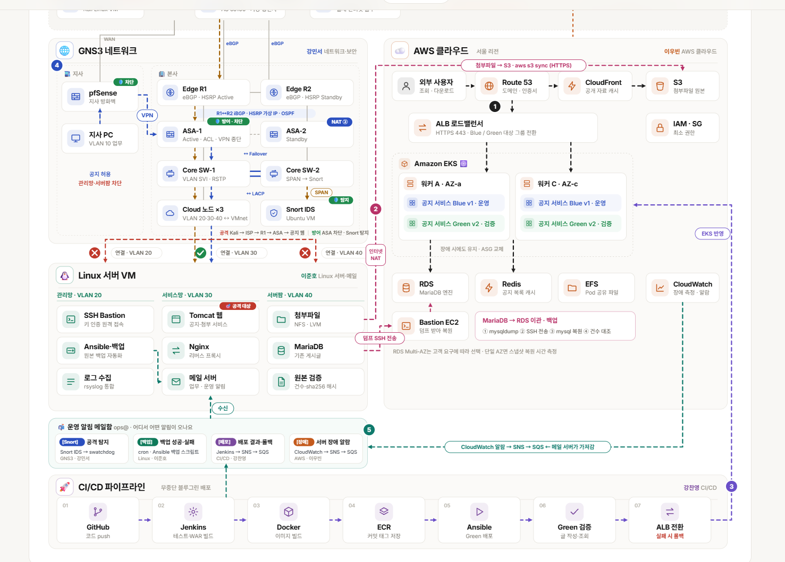

# ㈜스모크 · 공지·자료실 인프라 전환

**온프레미스 보안 인프라 재구축 및 AWS 마이그레이션을 통한 무중단 배포·장애 대응 체계 구축**

KDT 최종 프로젝트 · 스모커 팀 4인 · 2026.11–12 · 설계 및 구축 준비

[시스템 아키텍처](docs/architecture/README.md) · [요구사항 명세서](docs/requirements/README.md) · [일정과 검증 계획](docs/delivery/README.md) · [수행계획서 원본](docs/originals/project-plan.docx)

## 프로젝트 소개

본사 서버 한 대가 사내 업무와 외부 공지·첨부파일 배포를 함께 맡고 있다. 웹 서버에서 비정상 접근 흔적이 발견됐지만 로그가 흩어져 경로를 추적하기 어렵다. 첨부파일이 쌓일수록 디스크가 부족해지고, 새 버전을 배포하려고 Tomcat을 재시작하면 공지를 읽던 사용자도 영향을 받는다.

우리 팀은 사내망을 접근 목적에 따라 나누고, 외부 공지·자료실을 AWS로 옮긴다. **기존 글과 파일이 그대로인지, 배포 중에도 공지를 읽을 수 있는지, 장애가 났을 때 소규모 운영팀이 알림을 받고 복구할 수 있는지**를 실제 요청과 로그로 검증하는 프로젝트다.

## 시스템 한눈에 보기

| 흐름 | 설계 |
| --- | --- |
| 사용자 요청 | 공지 조회는 HTTPS ALB를 거쳐 EKS로, 공개 자료 다운로드는 CloudFront를 거쳐 비공개 S3로 전달한다. |
| 원본 이관 | 게시글은 MariaDB에서 RDS로, 첨부파일은 S3로 옮긴다. 전후 건수·대표 본문·파일 해시를 대조한다. |
| 배포와 복귀 | GitHub 커밋 → Jenkins 테스트·WAR 빌드 → Docker·ECR → Ansible·EKS 후보 배포 → 기능 검사 → ALB 전환. 전환 후 검사에 실패하면 직전 버전으로 복귀한다. |
| 운영 알림 | 보안 탐지, 백업, 클라우드 장애, 배포 결과를 운영 메일함에서 확인한다. |

## 팀과 작업 폴더

| 담당자 | 역할 | 이 폴더에 올릴 작업 |
| --- | --- | --- |
| **강민서** | PM · 네트워크·보안 | 본사·지사 토폴로지, VLAN·VPN 정책, 이중화 및 IDS 검증 기록 · [network/](network/) |
| **이준호** | Linux 서버·메일 | 서버 설정, 백업, 이관 원본 목록과 운영 알림 수신 기록 · [server/](server/) |
| **이우빈** | AWS 클라우드 | VPC·EKS·ALB 구성, 데이터 이관, 장애 복구 및 비용 측정 · [aws/](aws/) |
| **강찬영** | CI/CD | Jenkins·Maven·Docker·ECR, Ansible 후보 배포, 기능 검사와 자동 롤백 · [cicd/](cicd/) |

## 최종 시연에서 확인할 것

1. **데이터 보존** — 이전 전후 게시글 건수, 대표 글 본문, 첨부파일 SHA-256을 대조한다.
2. **무중단 배포** — 공지를 연속 조회하면서 Blue에서 Green으로 전환하고 총 요청 수와 실패 수를 기록한다. 목표는 조회 실패 0건이다.
3. **자동 복귀** — 후보 검증 실패 시 전환을 중단하고, 전환 후 오류 시에는 Blue 응답이 돌아오기까지의 시간을 측정한다.
4. **장애 대응** — 워커 한 대를 중단했을 때 공지 조회가 유지되는지 확인한다. 사용자 요청의 영향과 대체 워커 투입 시간을 따로 기록한다.

각 담당자는 자신의 폴더에서 작업을 시작하고, 통합 시연 결과는 [검증 계획](docs/delivery/README.md)의 요구사항 ID와 연결한다.

[고객 시나리오 원본 화면](docs/images/scenario.png) · [제공 자료 전체 목록](docs/originals/README.md)
