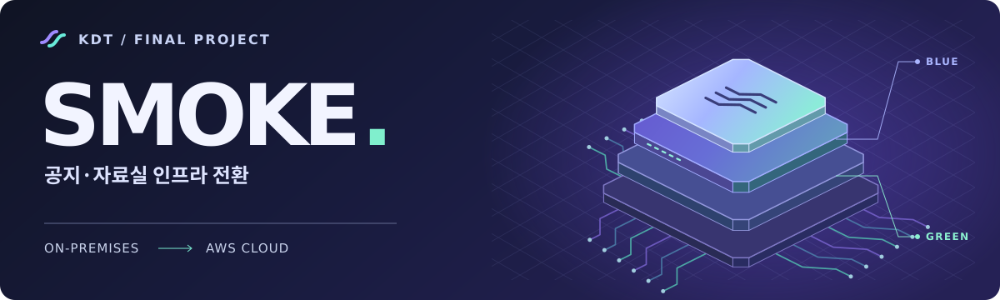
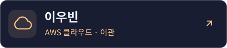

# ㈜스모크 | 공지·자료실 인프라 전환

**온프레미스 보안 인프라 재구축 및 AWS 마이그레이션을 통한 무중단 배포·장애 대응 체계 구축**

KDT 최종 프로젝트　·　스모커 팀 4인　·　2026.11–12　·　설계 및 구축 준비

**프로젝트 문서**　 [아키텍처](docs/architecture/README.md)　/　[요구사항 명세서](docs/requirements/README.md)　/　[일정과 검증 계획](docs/delivery/README.md)　/　[수행계획서 원본](docs/originals/project-plan.docx)

## 프로젝트 소개

직원이 공지를 올리고 외부 사용자가 첨부파일을 내려받는 동안, 본사 서버 한 대가 사내 업무와 외부 서비스를 모두 처리한다. 웹 서버에 비정상 접근 흔적이 남아도 로그가 흩어져 경로를 추적하기 어렵고, 새 버전을 배포하려고 Tomcat을 재시작하면 읽던 공지도 끊긴다.

스모커 팀은 **사내망을 접근 목적별로 분리하고, 외부 공지·자료실을 AWS 두 가용 영역으로 이전**한다. 고객이 계속 쓰던 글과 파일을 보존하고, 배포 중에도 같은 주소에서 공지를 읽을 수 있게 하는 것이 목표다.

## 팀 워크스페이스

담당자 카드를 누르면 해당 파트의 작업 폴더와 연동 안내가 열린다.

| 온프레미스 | AWS · 배포 |
| :--- | :--- |
|  |  |
|  |  |

## 시스템 아키텍처

| 경로 | 서비스가 동작하는 방식 |
| --- | --- |
| **공지 조회** | HTTPS 요청은 ALB를 거쳐 운영 중인 EKS 버전으로 들어간다. 첨부파일은 CloudFront가 비공개 S3에서 가져와 제공한다. |
| **데이터 이관** | MariaDB 게시글은 RDS로, 첨부파일은 S3로 옮긴다. 전후 게시글 건수·대표 본문·파일 해시를 원본과 대조한다. |
| **배포와 복귀** | Jenkins가 테스트와 WAR 빌드를 실행한다. 커밋 태그를 붙인 Docker 이미지를 ECR에 올린 뒤 Ansible로 Green에 배포하고, 공지 작성·조회에 성공하면 ALB를 전환한다. |
| **운영 알림** | Snort 탐지, 백업 결과, CloudWatch 장애 경보, Jenkins 배포 결과를 운영 메일함에서 확인한다. |

## 최종 시연

| 시나리오 | 확인할 결과 |
| --- | --- |
| **원본을 보존했는가?** | 이관 전후 게시글 건수·대표 본문과 첨부파일 SHA-256이 일치한다. |
| **배포 중에도 공지를 읽을 수 있는가?** | 운영 주소를 연속 조회하며 Blue → Green 전환 전후의 응답 버전과 총 요청 수를 기록한다. 목표는 조회 실패 **0건**이다. |
| **새 버전에 오류가 생기면 어떻게 되는가?** | 전환 전 검사에 실패하면 Blue를 유지한다. 전환 후 검사에 실패하면 Blue로 자동 복귀하고 이전 버전이 다시 응답하기까지의 시간을 잰다. |
| **워커 한 대가 멈추면 어떤 영향이 있는가?** | 사용자 요청의 실패·회복 시각과 ASG 대체 워커의 준비 시각을 각각 기록한다. |

[시연 측정값 기록표](docs/delivery/README.md)　·　[고객 시나리오 원본 화면](docs/images/scenario.png)　·　[제공 자료 전체 목록](docs/originals/README.md)
