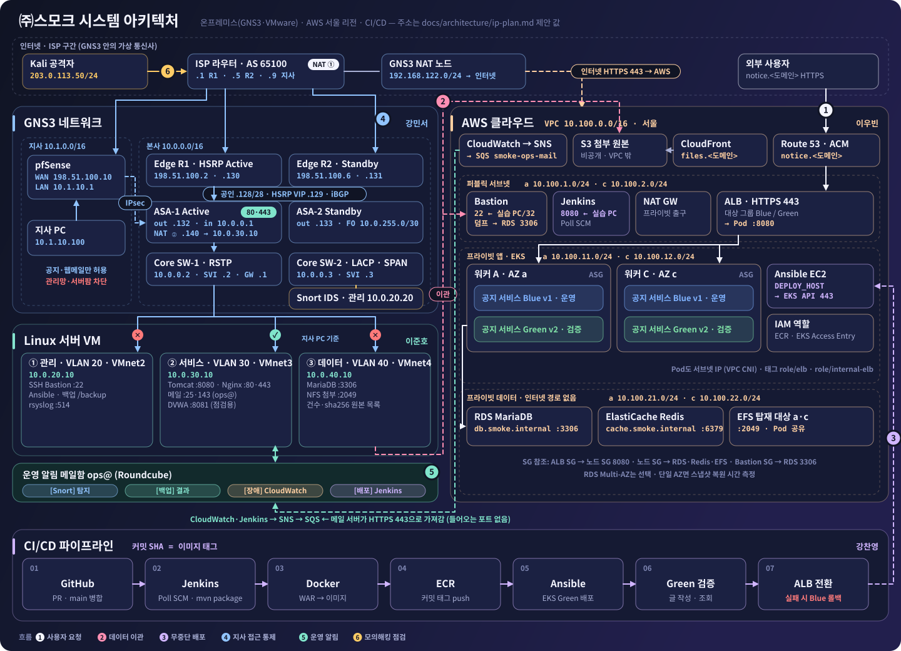
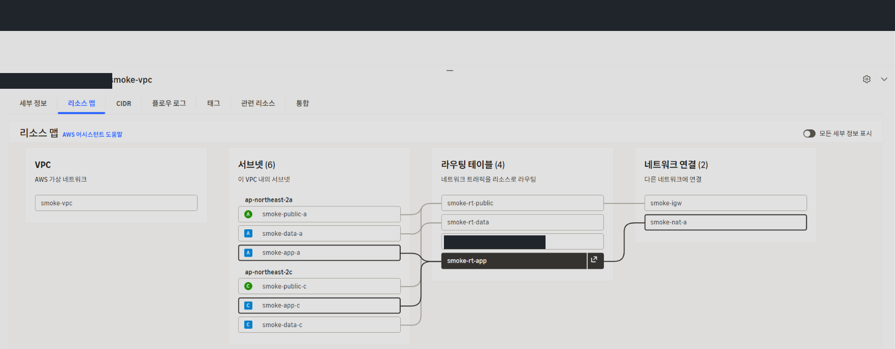
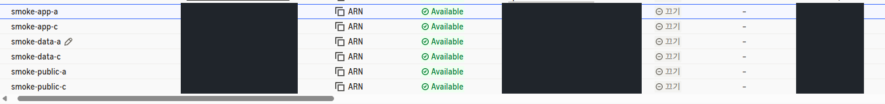

# AWS 클라우드

**담당자 메일**　[woobin6318@gmail.com](mailto:woobin6318@gmail.com)　·　[프로젝트 홈](../README.md)　·　[요구사항](../docs/requirements/README.md)

두 가용 영역의 서비스 운영 기반을 만들고 데이터 이관과 장애 복구를 검증한다.

| 작업 위치 | 올릴 내용 |
| --- | --- |
| [infrastructure/](infrastructure/) | VPC·EKS·ALB, IAM·보안 그룹 및 대상 그룹 구성 |
| [migration/](migration/) | RDS·S3 이관 절차와 원본 대조 결과 |
| [operations/](operations/) | 전환·복귀 스크립트, 복구 시간과 실제 비용 기록 |

## 최신 현황 (2026-11-27)

[DAY 2 작업일지](WORKLOG.md) · [ECR 조회 원문 발췌](verification/1127-ecr-images-masked.log). 팀 Ansible EKS 접근 및 정적 ALB 전환/복귀 검증 성공. RDS/EFS/S3 이관 일치 결과는 대화 회수 요약이며 실제 앱 통합 및 HTTPS/CloudFront 검증은 별도. 아래는 전날 기록이다.

## 현재 구축 현황 (2026-11-26 당시)

[팀 공유 인계 PR #15](https://github.com/CHANYOUNGKANG/Final_4gl_team_smoke/pull/15)의 AWS 담당자 보고 기준으로 Terraform EKS 및 Managed Node Group 구축 완료: 두 프라이빗 앱 서브넷의 t3.medium 워커 2대, Private Only API, 워커 2/2 Ready 및 시스템 Pod 6/6 Running, 재시작 0회. 실제 Terraform 원본·검증 화면 및 로그는 추가 제출 대기 중이다.

Access Entry와 notice namespace RBAC 설정 진행 중이며 Ansible 접속 검증, AWS Load Balancer Controller 및 ALB Blue/Green 구성은 후속 작업이다.

[상세 작업일지](WORKLOG.md) · [EKS 구축 보고 및 CI/CD 인계](infrastructure/eks-handoff-2026-11-26.md)

## 작업 체크리스트

- [ ] 예산·가동 시간을 합의하고 Jenkins EC2 접근 경로와 Poll SCM 기준을 강찬영에게 전달한다. Webhook 도입은 공개 수신 경로를 별도 합의한 경우에 검토한다.
- [ ] 두 AZ의 EKS와 HTTPS ALB를 준비하고 ECR 위치·대상 그룹·전환 및 복귀 절차를 강찬영과 대조한다.
- [ ] 원본 게시글과 첨부파일을 RDS·S3로 이관하고 이준호와 [이관 결과](migration/)를 검증한다.
- [ ] 워커 장애 영향·ASG 교체 시간, 백업 복원과 블루그린 중복 운영 비용을 [운영 기록](operations/)에 남긴다.

[첫날 작업표와 파트 간 인계](../docs/delivery/README.md#첫날-작업표) · [시연 결과 기록](../docs/delivery/README.md#결과-기록표) · [작업 양식](../docs/templates/README.md) · [작업 이슈 열기](https://github.com/CHANYOUNGKANG/Final_4gl_team_smoke/issues/new?template=team-task.yml) · [인계 요청](https://github.com/CHANYOUNGKANG/Final_4gl_team_smoke/issues/new?template=handoff.yml)

## 팀 연동

이준호와 이관을 대조하고, 강찬영과 ECR 저장소·EKS 대상·ALB 전환 및 복귀 절차를 연결한다.

## 최신 구축 현황 — 2026-11-26

[상세 작업일지](WORKLOG.md) · [EKS 관찰 기록](verification/1126-eks-observations.log) · [원문 CLI의 공개용 발췌](verification/1126-aws-cli-masked.log) · [실제 캡처](evidence/) · [인계 Issue #11](https://github.com/CHANYOUNGKANG/Final_4gl_team_smoke/issues/11)

이번 기록은 프로젝트 대화에서 확인한 실행 결과와 실제 첨부 원본, 최신 팀 로그를 모아 작성했다. 회수한 결과의 요약과 원문 발췌를 구분하며, 원본을 확보하지 못한 Terraform 코드를 재작성해 실행한 파일처럼 올리지 않는다.

| 항목 | 현재 확인한 상태 | 근거·남은 범위 |
| --- | --- | --- |
| VPC·서브넷·NAT | 두 AZ의 public/app/data 서브넷 6개, 콘솔에서 모두 Available. 실제 CLI에서 NAT Gateway 1개 available | [VPC 화면](evidence/1126-vpc-map-masked.png), [서브넷 화면](evidence/1126-subnets-masked.png), [CLI](verification/1126-aws-cli-masked.log). 모든 경로의 통신 시험과는 구분 |
| 보안 그룹 | 프로젝트 SG 목록과 Jenkins SG → Ansible SG의 SSH/TCP 22 허용 규칙 확인 | [SG 목록](evidence/1126-security-groups-masked.png), [인바운드](evidence/1126-ansible-ssh-rule-masked.png). 원본에서 두 SG ID를 대조하고 공개본은 식별자를 가림 |
| EKS·노드 그룹 | 계획에서 Kubernetes 1.37, private API, 앱 서브넷 2개, t3.medium·desired 2/min 2/max 3. 적용 후 회수한 출력에서 버전 1.37 및 노드 그룹 ACTIVE | [EKS 관찰 기록](verification/1126-eks-observations.log). 계획값과 실제 관찰 결과를 구분 |
| Kubernetes 실행 상태 | 17:16 KST 기준 노드 2대 Ready, 확인된 시스템 Pod 6개 Running·restart 0 | 실제 노드 버전 v1.37.1-eks-9adbfea, Amazon Linux 2023. 노드별 AZ와 업무 앱 배포는 미검증 |
| CI/CD 인계 | 팀원 로그의 Jenkins → Ansible SSH·local ping·STS 및 테스트 앱 빌드 성공 참조 | [원격 점검](../cicd/verification/ansible-remote-check.log), [Jenkins #8](../cicd/verification/smoke-test-build-8-ansible.log). EKS 업무 앱 배포 성공으로 확대하지 않음 |
| RDS | DB 서브넷 그룹 생성 완료에 대한 사용자 보고 | DB 인스턴스·실제 접속·데이터 이관 완료와 구분 |
| 도메인·ACM | 실제 도메인 등록 실패 화면 확보, 이후 도메인·ACM 작업 보류 보고 | [등록 실패](evidence/1126-domain-registration-failed-masked.png), [사용 불가 오류](evidence/1126-domain-unavailable-masked.png). 초기 HTTP 후 HTTPS 전환을 협의하는 공통 기준 적용 |

첫 네 개의 체크리스트는 여러 인수 조건을 묶은 항목이다. 일부 기반 구축만 확인된 상태에서 전체 완료로 체크하지 않는다. AWS1에는 노드·시스템 Pod의 **부분 실행 근거만** 등록하며, 두 AZ의 EKS 구현 전체를 입증하는 근거가 없으므로 점수를 임의 상향하지 않는다.

## 사용 기술과 확인 범위

VPC·서브넷·보안 그룹은 서비스와 관리 통신의 경계를 구성하고, NAT는 프라이빗 계층의 외부 접근 경로를 마련한다. Terraform은 EKS 변경 계획을 관리하고 EKS 관리형 노드 그룹은 Kubernetes 실행 기반을 제공한다. Ansible·AWS CLI·IAM Role은 CI/CD의 원격 작업과 AWS 접근에 사용한다. 선정 목적과 실제 성능·비용 개선 실측은 별도로 구분한다.

팀원 원격 점검 로그의 도구 버전은 Ansible Core 2.16.3, Python 3.12.3, Git 2.43.0, AWS CLI 2.42.4다. Terraform CLI 및 kubectl 클라이언트 버전은 아직 원문으로 확인하지 못했다. 명령별 사용 이유와 환경·권한의 확인 범위는 [작업일지](WORKLOG.md)에 정리했다.

## 전체 설계와 실제 기반 화면

아래 구성도는 저장소의 **공통 설계**다. 배치도 자체를 모든 서비스의 구축 완료 증거로 사용하지 않는다.

### VPC의 두 AZ 및 세 계층 서브넷

실제 AWS 콘솔 원본의 식별자를 불투명하게 제거한 사본이다. ap-northeast-2a/c의 public/app/data 구성, 서브넷 6개, 라우팅 테이블 4개와 IGW·NAT 항목을 보여 준다. 네트워크 연결 2개는 **IGW와 NAT**이며 NAT Gateway 2개라는 뜻이 아니다.

서브넷의 Available 상태를 확인한 화면이며 EKS 노드가 두 AZ에 분산됐다는 증거는 별도로 필요하다. 나머지 실제 캡처 5장과 설명은 [작업일지](WORKLOG.md)와 [발표 자료 색인](../docs/presentation/README.md)에 연결했다.

## 다음 작업과 협업

1. **이우빈:** 사용한 Terraform 원본·실제 EKS 설정과 노드 AZ 라벨을 확보해 구성과 관찰 결과를 대조한다.
2. **이우빈 ↔ 강찬영:** PR #15에 기록된 Access Entry 및 `notice` namespace / `smoke-deployers` RBAC 설정 진행 상태를 인계하고, 동일 Ansible 역할의 `eks:ListClusters` 상태와 필요한 EKS Access Entry/RBAC·프라이빗 API 접근을 확인한다. 사용자 kubectl 성공을 다른 주체의 권한 해결로 간주하지 않는다.
3. **이우빈 ↔ 강찬영·이준호:** 실제 후보 앱, RDS·첨부 저장소 조건을 [Issue #11](https://github.com/CHANYOUNGKANG/Final_4gl_team_smoke/issues/11)에서 맞춘 뒤 EKS 배포·접속을 검증한다.
4. **이우빈:** ALB 전환·복귀, 데이터 이관 대조, 워커 장애·복구 시간·비용을 실제 실행 순서대로 기록한다.

아웃바운드 캡처는 전체 트래픽 `0.0.0.0/0` 규칙을 보여 주지만 화면에 SG 이름이 없다. 어느 SG인지 원본 문맥과 대조한 뒤 필요한 최소 권한 범위를 협의한다. 이미 제한한 것처럼 기록하거나 이번 문서 작업으로 AWS 구성을 임의 변경하지 않는다.
