# AWS 작업일지

담당자: **이우빈 · AWS 클라우드 인프라**

이 문서는 날짜별 수행 기록을 최신 날짜부터 누적한다. 실제 실행 결과, 사용자 완료 보고, 팀원 인계 결과, 설계·계획을 구분한다. 실제 환경에서 실행하지 않은 코드나 확보하지 못한 출력은 실행 기록으로 작성하지 않는다.

[AWS 현황](README.md) · [공통 요구사항](../docs/requirements/README.md) · [IP·통신 설계](../docs/architecture/ip-plan.md) · [진행률 기준](../docs/progress/README.md)

---

## 2026-11-28 — DAY 2 기록 재게시와 진행률 근거 보완

오늘 수행한 작업은 **11/27 자료 회수·원본 대조·마스킹·문서화·GitHub 반영**이다. AWS·EC2·Kubernetes에서 새 구축이나 시험을 실행한 것이 아니다. 작업 날짜를 11/28의 새 AWS 실적으로 바꾸지 않았다.

1차 점검에서는 대화 검색 오류가 있었고 PR #27에 콘솔 원본 9장을 보완했다. 이 PR은 11/28 19:47:40 KST에 main에 병합됐다. 이후 이번 재조회에서는 실제 대화 검색이 응답했고, EKS 노드 AZ·RDS 복원 명령·EFS/S3 해시·당일 마지막 후속 결과를 추가 회수했다. 실제 인계 압축파일 내부의 집계·해시·JPG 바이트와 대조했고, 원본 schema.sql은 공용 app/sql/schema.sql과 바이트가 같음을 확인했다.

진행률은 첨부 지침과 저장소의 기존 기준인 **구현 또는 부분 구현 1점 + 완료 조건에 맞는 실행 근거 1점**으로 다시 등록한다. 1차 점검에서 부분 구현도 전체 완료처럼 엄격하게 판단한 부분을 정정한다. 공통 계산 코드는 바꾸지 않으며 다른 팀원의 evidence 기록을 보존한다. [원인·1차 이력·후속 정정](operations/1128-progress-review.md)에 상세 근거를 남겼다.

기존 11/27 캡처 9장은 재사용하고, 저장된 ALB·RDS·EFS 보안 그룹 규칙 화면 **3장**만 추가로 마스킹했다. 기존 11/26 캡처 7장을 포함해 AWS 증빙 이미지는 총 19장이다. 실제 원본과 공개본의 마스크 밖 픽셀을 대조했고 PNG 부가 메타데이터를 제거했다.

작업 중 main에 추가된 서버 DAY2 PR #30도 확인했다. 최신 main의 팀원 파일·증빙과 자동 갱신 README를 보존하는 기준으로 동기화한다. 이번 수정은 AWS 담당 자료와 관련 공용 일지·증빙 색인·이관 결과 행에 한정한다.

---

## 2026-11-27 — DAY 2 AWS 상세 (11/28 재조회 보완)

### 목적·사용 기술·전체 시스템에서의 역할

EKS 기반을 CI/CD에 인계하고, ALB의 두 대상 그룹을 연결하며, 온프레미스 데이터를 RDS·EFS·S3로 옮긴 결과를 확인했다. EKS는 앱 실행 기반, Access Entry/RBAC는 배포 주체의 접근 통제, ALB는 슬롯별 트래픽 연결, RDS는 DB 대상, EFS는 공유 첨부, S3는 객체 보관·후속 배포 경로다. 선택한 기술의 목적과 실제 성능·비용·장애 복구 실측은 구분한다.

[공용 아키텍처](../docs/architecture/README.md)와 [IP·통신 허용표](../docs/architecture/ip-plan.md)를 설계 기준으로 재사용한다. 현재 자료와 다른 HTTPS·SG 출발지·버전·FILE_BASE_URL 상태는 [인계·차이점](operations/1127-sync-and-handoff.md)에 기록했고 인프라를 임의로 바꾸지 않았다.

### 환경·권한·확인된 버전

| 항목 | 실제 확인 내용 | 출처·제한 |
| --- | --- | --- |
| AWS 위치 | ap-northeast-2, 노드 AZ 2a·2c | 09:17:41 사용자 출력 |
| AWS 명령 실행 주체 | Terraform EC2 / ec2-user | 노드 조회·RDS 복원·EFS 전송·S3 해시의 회수 문맥. 실제 주소 비공개 |
| DB/첨부 작업 위치 | ~/smoke-db/handoff-20261127-1404 | 16:19:48·16:25:58·16:35:22 사용자 문맥 |
| EKS | 제어 영역 1.37 ACTIVE, private API | 팀 오전 DescribeCluster 로그. 워커 OS AL2023·amd64는 11/26 확인 이력 |
| Helm / LBC | Helm v4.3.2, chart 3.6.2, STATUS deployed | 11:05:34 사용자. Controller 이미지/App version 미확인 |
| DB | 원본 10.11.19-MariaDB / RDS 10.11.19-MariaDB-log | 실제 인계 파일 / 16:19:48 사용자 |
| 파일 경로·권한 | /var/smoke/attach, UID:GID1500:1500, 실제 첨부 -rw-r----- | 16:25:58 두 AZ 결과 |
| Ansible·앱 인계 | ansadmin, kubectl1.37.3, Ansible2.16.3·Python3.12.3; 최종 앱 Java17·Tomcat10.1 | [팀 오전 로그](../cicd/verification/1127-day2-midpoint.md), [DAY2 회의록](../docs/daily/1127-meeting.md). 팀원의 구현 실적과 구분 |

### 시간순 실제 수행·검증

아래 시각은 **원래 사용자 메시지 KST**이며 캡처 업로드 시각과 구분한다. 명령·출력의 회수 범위와 생략 여부는 [검증 로그](verification/1127-recovered-user-results.log)에 적었다.

| 시각 KST | 작업과 확인 결과 | 상세 근거 |
| --- | --- | --- |
| 09:17:41 | 노드 2개 Ready, 각각 2a·2c; Pod6 Running·restart0. 접근 그룹 불일치 발견 | [EKS·접근 인계](infrastructure/1127-eks-access-and-controller.md) |
| 09:18:59 | Access Entry의 그룹이 RoleBinding과 일치하는 후속 출력 | 같은 문서. 수정 제안 명령을 실제 실행으로 쓰지 않음 |
| 11:05:34 | Helm 실제 설치 명령, chart3.6.2, STATUS deployed·revision1 | 같은 문서·사용자 로그. 이미지 태그 미확인 |
| 오전~점심 | ALB Blue/Green 대상 각각 Healthy2, HTTP80 Blue100/Green0, 정적 test-v2 응답 | 아래 실제 캡처와 [콘솔 구성](infrastructure/1127-console-configuration.md) |
| 15:16:14 | EFS PV5Gi/RWX/Retain·PVC Bound, 두 AZ 공유 쓰기 시험 | [이관 과정](migration/1127-source-and-target-evidence.md). 시험 파일 해시와 실제 첨부 해시는 별개 |
| 16:19:48 | RDS 복원·스키마 적용 각각 exit0; 14/1/6과 비교 digest | 같은 문서. 실제 원본의 다섯 값과 대조 |
| 16:25:58 | 실제 첨부 EFS 전송 exit0; 두 AZ189,525bytes·1500:1500·동일SHA | 같은 문서. 원래 tar/kubectl 명령 순서 보존 |
| 16:35:22 | S3 AES256·189,525bytes·image/jpeg, 다운로드 SHA 일치 | 같은 문서. 실제 인계 JPG 바이트와 재대조 |
| 17:08:11 | S3 PAB4개true·Versioning Enabled·익명 직접접근403 | [사용자 로그](verification/1127-recovered-user-results.log). ALB HTTPS와 구분 |
| 17:22:05 | 수동 S3 동기화 Job Complete1/1·24초; CronJob suspend=True·LAST SCHEDULE 없음 | [운영 기록](operations/1127-sync-and-handoff.md) |
| 17:23:21 | 후속 작업은 월요일에 하기로 한 사용자 결정 | 같은 문서. 11/30 계획으로 분리 |
| 17:27:40 | 사용자 후속: Blue/Green 각2Pod Running·PVC Bound/RWX, CronJob정지·수동Job완료 유지 | 전체 원문 아닌 회수 요약. 최종 앱 기능·rollout·TG 검증과 구분 |

### 실제 명령·파일과 구축 전후의 차이

- **접근·Controller:** 노드 AZ 조회와 Helm 설치 실제 명령을 [infrastructure](infrastructure/1127-eks-access-and-controller.md)에 보존했다. 초기 그룹 불일치→후속 그룹 일치, 초기 Helm 미설치→install deployed로 상태를 갱신했다.
- **DB 이관:** 실제 gzip/sed 변환→mysql 복원→schema 적용→비교 뷰 조회 순서를 [migration](migration/1127-source-and-target-evidence.md)와 [검증 발췌](verification/1127-recovered-user-results.log)에 기록했다. RDS 사용 가능 화면에서 나아가 실제 DB 결과와 원본 대조를 연결했다.
- **파일 이관:** 실제 tar→kubectl exec→두 Pod sha256sum 순서를 보존했다. S3는 확인된 명령 조각과 실제 결과만 기록하고 생략 옵션을 임의 완성하지 않았다.
- **실제 확보한 코드:** 첨부 schema.sql은 [공용 스키마](../app/sql/schema.sql)와 바이트가 같아 기존 파일을 연결했다. 원문 없는 Terraform·IAM/RBAC·PV/PVC·CronJob YAML을 새로 만들어 당시 실행 코드라고 올리지 않았다.
- **권한·실행 주체:** AWS 담당의 실행과 팀 Ansible/Jenkins 결과를 분리한다. 사용자 성공 한 건을 다른 역할·namespace 전체의 권한 완료로 해석하지 않는다.

### 원본·대상 무결성 대조

원본 인계는 14:04:54 KST 수집, 15:46:56 첨부된 자료다. 온프레미스 기준값과 회수한 RDS 결과의 notice14/file1/inquiry6, content_digest·file_digest가 모두 일치했다. EFS 두 AZ와 S3 다운로드의 실제 첨부 SHA-256도 원본 JPG 바이트·원본 DB/파일 해시 목록과 일치했다. 전체 64자리 값과 비교 범위는 [이관 대조표](migration/1127-source-and-target-evidence.md)에 있다.

이 대조는 실제 인계 원본과 11/27 사용자 실행 출력을 비교한 것이다. 오늘 새 RDS 질의나 S3 다운로드를 실행한 것으로 표현하지 않는다. 원본 DB 덤프·첨부 JPG 자체는 공개하지 않았다.

### 막힌 부분·해결·미완료

접근 그룹 불일치는 09:18:59 후속 출력으로 해소를 확인했다. Port Forward Forbidden과 PVC Forbidden은 팀 후속 성공 로그를 연결했다. RDS 덤프 필터 명령은 실제 회수했지만 에러 원문 없는 특정 오류 코드는 만들지 않았다.

HTTPS·CloudFront/OAC·실제 JSP 앱의 DB/첨부 통합·신규 파일 예약 동기화·워커 장애/복구·비용 시험은 여전히 남아 있다. 수동 동기화 성공을 정기 실행 성공으로, S3 익명403을 ALB HTTPS 성공으로, Pod Running을 전체 앱 인수 완료로 바꾸지 않는다.

### 실제 콘솔 원본 12장과 증명 범위

아래 원본은 모두 11/27 프로젝트 첨부에서 확보했다. 시각은 **업로드 시각(KST)**이며 원래 메시지 시각·캡처 시각으로 대신 쓰지 않는다. 원본과 공개본에서 마스크 밖 픽셀을 대조하고, 계정·관리 주소·리소스 식별자를 불투명하게 제거했다.

#### 1. Blue 대상 그룹 — 11:36:27 업로드

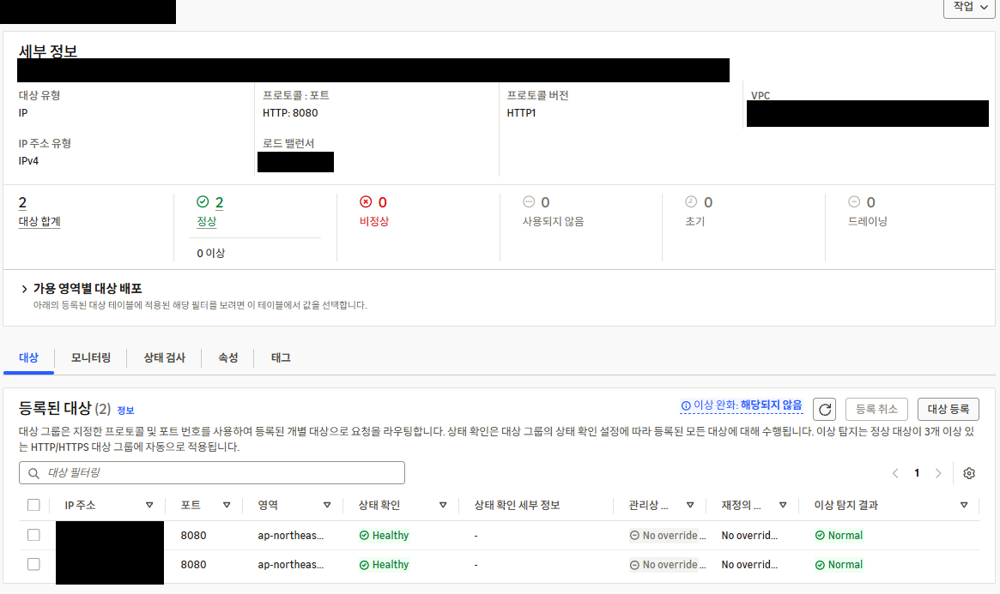

목적은 Blue 대상 등록과 상태 확인이다. IP 타입·HTTP 8080·대상 2개 Healthy가 보인다. 이 한 장으로 HTTPS나 전체 서비스의 무중단을 증명하지 않는다. 원본: `image(20261127-023628).png`.

#### 2. Green 대상 그룹 — 11:36:41 업로드

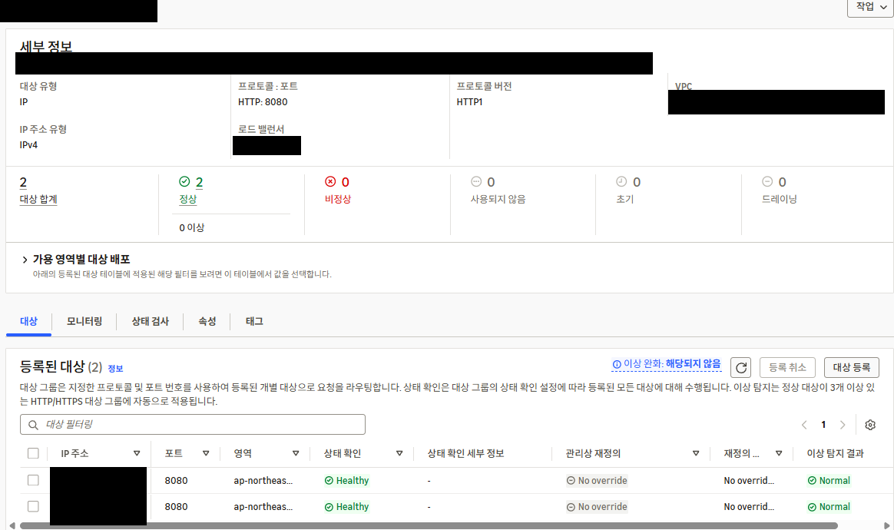

목적은 후보 대상 그룹의 상태 확인이다. IP 타입·HTTP 8080·대상 2개 Healthy가 보인다. 실제 업무 앱의 DB·첨부 연동과는 별도다. 원본: `image(20261127-023642).png`.

#### 3. ALB HTTP 시험 응답 — 11:38:47 업로드

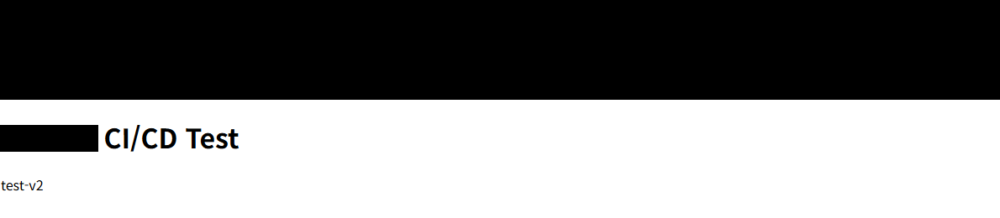

목적은 ALB 주소로 정적 시험 페이지가 응답하는지 확인하는 것이다. 화면은 test-v2 응답을 보여 준다. HTTP 상태 코드나 TLS 성공을 이 캡처에서 별도로 읽어낸 것으로 표현하지 않는다. 원본: `image(20261127-023848).png`.

#### 4. 실제 리스너 설정 — 11:45:07 업로드

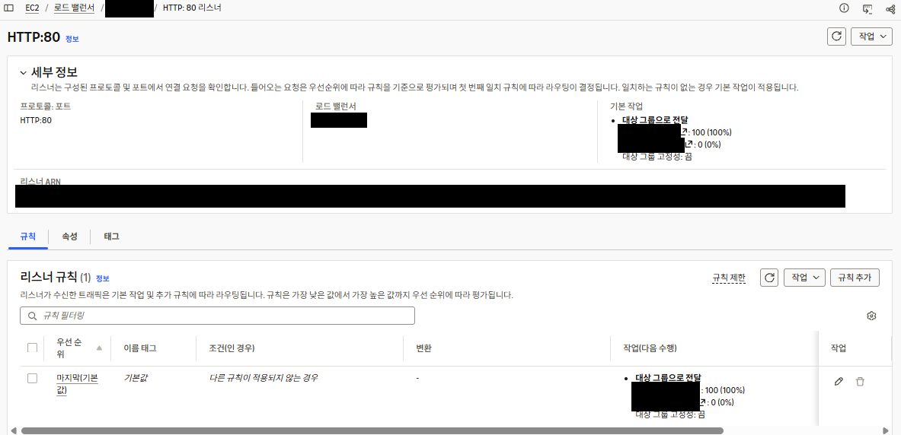

저장된 HTTP:80 리스너의 Blue 100 / Green 0 전달 설정을 확인한다. 전환·복귀 전 과정은 팀 로그를 함께 봐야 하며 HTTPS 리스너 화면이 아니다. 원본: `image(20261127-024508).png`.

#### 5. RDS DB subnet group — 12:29:46 업로드

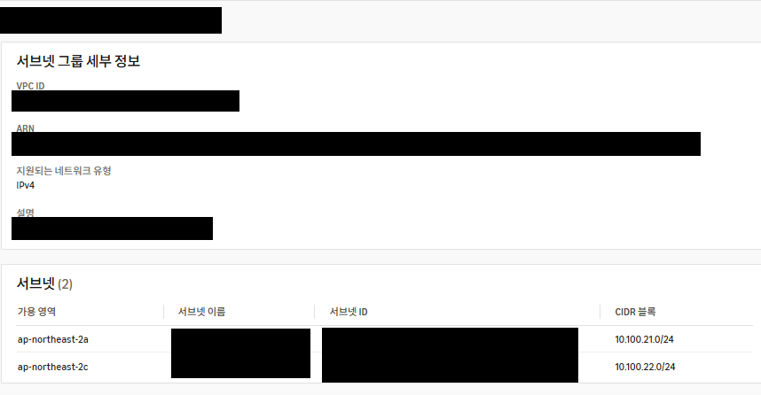

DB subnet group의 ap-northeast-2a/c를 확인한다. EKS 워커의 두 AZ 배치를 대신 입증하지 않는다. 원본: `image(20261127-032947).png`.

#### 6. EFS Access Point — 14:59:25 업로드

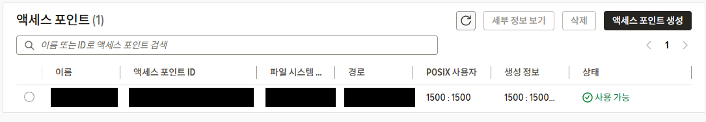

Access Point 1개 사용 가능 및 POSIX UID/GID 1500:1500을 확인한다. 표시된 경로가 잘려 전체 경로를 추정하지 않았고, 두 AZ mount target·실제 mount·파일 해시는 별도 근거가 필요하다. 원본: `image(20261127-055926).png`.

#### 7. RDS 인스턴스 — 15:19:00 업로드

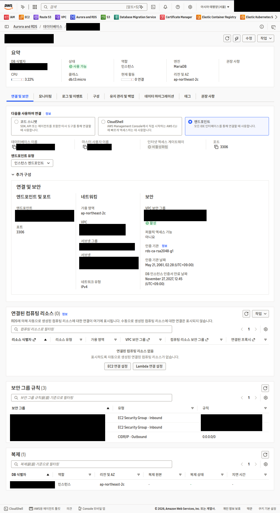

MariaDB, db.t3.micro, AZ ap-northeast-2c, 사용 가능, 3306, 퍼블릭 액세스 아니요, 서브넷 2개를 확인한다. 엔진의 세부 버전과 DB 복원 이후 건수·해시를 보여 주는 화면은 아니다. 원본: `image(20261127-061901).png`.

#### 8. S3 버킷 — 16:34:52 업로드

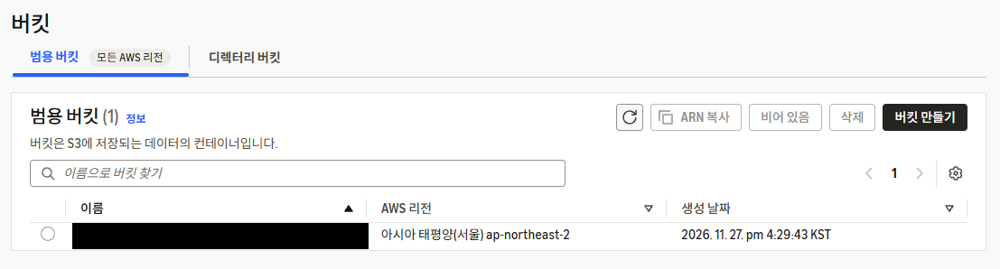

서울 리전 버킷 1개와 화면의 생성 시각 16:29:43 KST를 확인한다. 생성 전 양식의 보안 설정 선택을 생성 후 적용 검증으로 바꾸지 않는다. 원본: `image(20261127-073453).png`.

#### 9. S3 객체 — 16:35:10 업로드

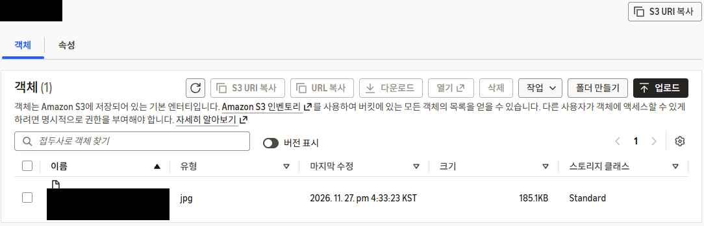

202611/ 아래 JPG 1개, 185.1 KB, 수정 시각 16:33:23 KST를 확인한다. 실제 원본 인계 목록과 같은 저장 이름임을 비공개 원본끼리 대조했으며 공개본의 식별자는 가렸다. 이 캡처 자체가 S3 재다운로드 SHA-256 일치를 보여 주는 것은 아니다. 원본: `image(20261127-073511).png`.

#### 10. ALB 보안 그룹 — 11:14:36 업로드

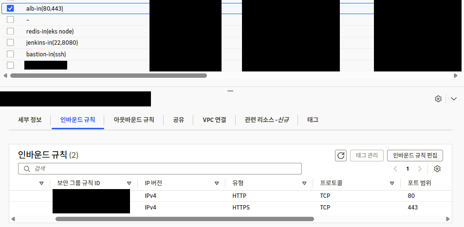

목적은 저장된 서비스 포트 규칙을 남기는 것이다. HTTP/TCP80·HTTPS/TCP443 두 규칙이 보인다. 소스 열은 화면 밖이라 허용 주소 범위는 미확인이다. HTTPS 리스너·인증서·접속 성공의 증거는 아니다. 원본: `image(20261127-021437).png`.

#### 11. RDS 보안 그룹 — 12:32:13 업로드

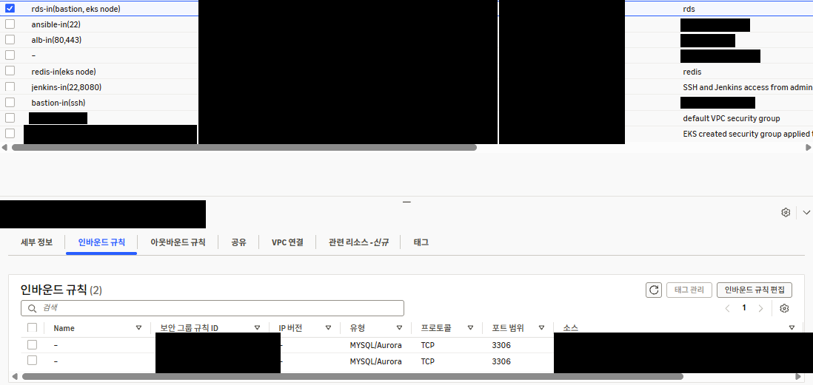

목적은 DB 접속 허용 경계를 확인하는 것이다. 원본 SG 이름·식별자를 대조해 TCP3306 출발지 두 개가 Bastion SG와 EKS cluster SG임을 확인했다. 공개 사본은 실제 식별자를 제거했다. 이 화면 자체는 데이터 복원 성공을 증명하지 않는다. 원본: `image(20261127-033214).png`.

#### 12. EFS 보안 그룹 — 12:45:53 업로드

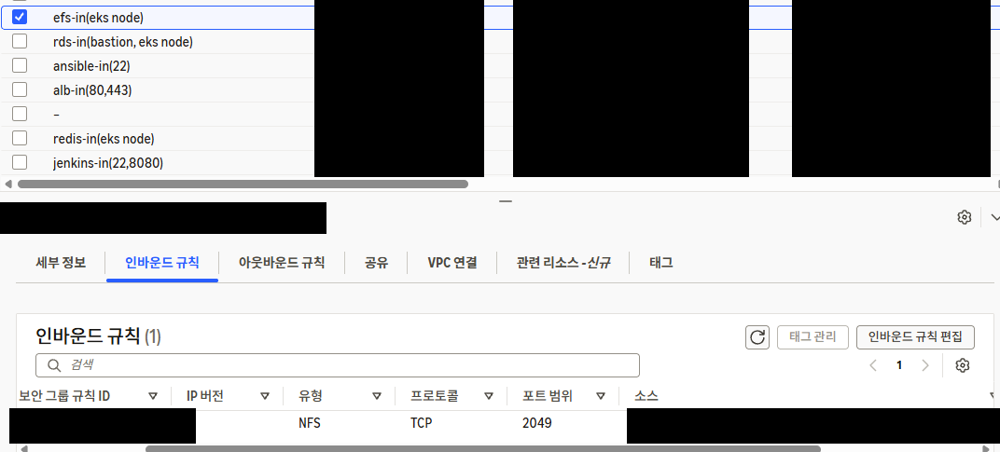

목적은 EFS 접속 허용 경계를 확인하는 것이다. 원본의 소스 SG를 대조해 EKS cluster SG임을 확인했다. NFS/TCP2049 규칙 존재와 실제 파일 공유 시험을 분리한다. 공통 설계의 노드 SG와 실제 연결 관계는 인계에서 추가 대조한다. 원본: `image(20261127-034554).png`.

### 팀원 실행 기록과 기여 구분

- [팀 오전 검증](../cicd/verification/1127-day2-midpoint.md): Ansible 역할·private API·namespace 권한·Port Forward 후속 성공. Jenkins와 Ansible 구현은 강찬영의 기여다.
- [Release #5](../cicd/verification/1127-notice-release-build-5-rollback.log): 정적 슬롯별 Healthy2, 전환20.23초·복귀21.56초, 최종Blue100/Green0.
- [연속 조회 집계](../cicd/verification/1127-alb-continuity-summary.md): 341/341 PASS, 실패0. 정적 시험·합성 실패의 결과이며 원본 CSV는 아직 미확보다.
- [오후 팀 로그](../cicd/verification/1127-day2-afternoon.log): PVC BOUND RWX, Green dry-run, 17:24 격리 후보 패치. 사용자의17:27 후속 요약을 함께 보되 최종 업무 앱 통합 검증으로 확대하지 않는다.
- [ECR 조회 발췌](verification/1127-ecr-images-masked.log)는 팀 CI 이미지와 연결한 AWS 담당 조회 자료다. CI 전체 구현 실적으로 바꾸지 않는다.

### 출처·수집 범위

11/28 20:16 KST 자료 정리 기준으로 프로젝트 「261127 2일차」와 관련 후속 메시지를 실제 검색했다. 메시지의 한국 날짜를 기준으로 11/27 오전부터23:59까지 찾았고, 이 회수분의 마지막 사용자 결과는 **17:27:40**이다. 이후 검색 결과가 없다고 실제 작업이 없었다고 단정하지 않는다. 전날 「IAM 권한 준비」 내용은 아래 11/26 이력과 이미 연결된 기록으로 보존했다.

Personal Context는 선택된 명령·출력과 요약을 반환했고 일부는 잘렸다. 제목이 명시 반환된 결과, 원래 USER 시각, 직접 첨부 원본, 팀 저장소 로그를 [검증 파일](verification/1127-recovered-user-results.log)에 구분했다. 모든 대화·PC/EC2 파일을 열람했다고 보장하지 않는다. 다른 학원 실습·개인 프로젝트 결과와 어시스턴트 제안 코드는 제외했다.

### 다음 작업과 꼭 필요한 누락 자료

[운영 인계표](operations/1127-sync-and-handoff.md)의 순서로 실제 업무 앱 통합→신규 파일 예약 동기화→HTTPS/CloudFront→워커 장애·비용 검증을 진행한다. 실제 Terraform·IAM/RBAC·PV/PVC·ServiceAccount/CronJob 파일과 LBC 이미지 태그, 후속 시험 출력은 아직 필요하다. 이미 확보한 RDS 명령·대상 대조·EFS/S3 해시·스키마·캡처는 재요청하지 않는다.

### 11/27 17:25 당시 회수 기록 (이력 보존)

아래는 기존 PR #27의 기록이다. 당시 대화 회수 요약과 이번 직접 확보한 원본을 구분하기 위해 남긴다. “신규 캡처 0장”은 당시 상태이며, 1차 보완의 9장은 11/28에 뒤늦게 회수한 11/27 원본이며 이번에 보안 그룹 3장을 추가했다.

수집 기준 17:25 KST. 프로젝트 「261127 2일차」 검색 결과와 실제 첨부 ECR CLI 및 팀원 저장소 기록을 대조했다. 대화 전체 및 신규 이미지 원본은 미확보. 이번 작업은 문서화이며 AWS 환경을 변경하지 않았다.

- 10:18 KST 첨부 ECR 조회에서 10:10:43 KST 등록된 이미지 태그와 digest를 확인했다. [CLI 발췌](verification/1127-ecr-images-masked.log). 팀 CI Build #3와 일치하며 CI 구현 자체는 팀원 성과다.
- [팀 오전 검증](../cicd/verification/1127-day2-midpoint.md): Ansible 역할 DescribeCluster 및 private API 접근, kubectl 1.37.3, notice Deployment/Service 작업 권한, Pod 조회/로그 확인. kube-system Deployment 생성 및 Node list 제한. Port Forward 권한 부족 후 get/create pods/portforward 재검증 성공. Blue/Green 각각 2/2 Ready, 총 4 Pod Running, 재시작 0.
- [CD #4](../cicd/verification/1127-notice-cd-build-4-deploy.log): 정적 Green test-v4 갱신, Blue test-v2 유지. [Release #5](../cicd/verification/1127-notice-release-build-5-rollback.log): 각 대상 그룹 healthy 2개, 전환 확인 20.23초, 의도적 검사 실패 후 복귀 확인 21.56초, 최종 Blue 100/Green 0. AWS 담당의 ELBv2 권한 추가는 팀원 보고이며 정책 원본 미확보.
- [연속 조회](../cicd/verification/1127-alb-continuity-summary.md): 341/341 성공, 실패 0, Blue 301/Green 40. 정적 테스트와 합성 assertion 실패이며 실제 장애 복구·HTTPS·업무 앱 무중단 보장은 아님. CSV 원본 미확보.
- 14:46 사용자 인계 요구: MariaDB 10.11 boarddb, RWX PVC, /var/smoke/attach, UID/GID 1500, UPLOAD_DIR, FILE_BASE_URL. 16:19~16:35 검색 회수 요약: RDS 10.11.19 복원 후 공지 14/첨부 1/문의 6 및 비교 digest 일치, 두 AZ EFS 테스트 Pod에서 189525 bytes 파일 해시 일치, S3 AES256 및 다운로드 해시 일치. 17:08 검색 회수 요약: Public Access Block 네 설정 true, Versioning Enabled, 비인증 직접 접근 403. 원문 전체 미확보이므로 요약으로만 기록.
- [팀 이미지 검증](../cicd/verification/1127-production-image-1500.log): 로컬 볼륨/H2 검사 성공, 실제 RDS/EFS 사용 아님. 특정 PVC get Forbidden, Secret get no. 필요한 PVC 조회만 협의하고 Secret 값은 공개하지 않는다.
- 다음: 실제 업무 앱 RDS/EFS 연결, CloudFront/OAC 및 FILE_BASE_URL, HTTPS, 워커 장애/비용 검증. Terraform, IAM/RBAC, PV/PVC, ALB 설정 및 원문 CLI/CSV 확보. 기존 [Issue #11](https://github.com/CHANYOUNGKANG/Final_4gl_team_smoke/issues/11) 참조. 신규 캡처 0장, 기존 7장 보존. 전체 이정표 근거 부족으로 점수 등록 변경 없음.


---

## 2026-11-26 — AWS 기반 현황 정리와 EKS 실행 상태 확인

### 1. 작업 목적과 이번 기록의 범위

SMOKE 프로젝트의 AWS 서비스 기반을 준비하고, CI/CD 담당자가 Jenkins와 Ansible을 거쳐 EKS 배포를 연계할 수 있도록 현재 구성과 검증 범위를 정리했다. 이번 기록의 핵심은 기존 네트워크 기반의 완료 보고, EKS 생성 계획과 적용 후 상태, 노드·시스템 Pod의 실행 상태, Ansible 인계 결과를 서로 연결하는 것이다.

**노드 2대의 Ready 및 시스템 Pod 6개의 Running 상태는 확인된 범위다.** 앱 배포, ALB 전환·복귀, 데이터 이관, 워커 장애 복구까지 성공했다는 의미로 확대하지 않는다. 노드 2대가 실제로 서로 다른 AZ에 배치됐는지도 아직 별도 증빙이 필요하다.

이 문서의 Terraform 계획·적용 결과와 kubectl 관찰 내용은 「IAM 권한 준비」 대화에서 회수한 내용에 근거한 **관찰 요약**이다. 원본 터미널 로그 전체를 그대로 저장한 기록으로 취급하지 않는다. 별도로 확보한 AWS CLI 첨부 원문과 실제 콘솔 이미지 7장은 아래에서 각각 원문 발췌와 이미지 증빙으로 구분한다.

### 2. 증거의 종류와 판정 방식

| 구분 | 이번 기록에 해당하는 자료 | 판정 범위 |
| --- | --- | --- |
| 사용자 완료 보고 | VPC·NAT Gateway·서브넷·라우팅·DNS·보안 그룹·RDS DB 서브넷 그룹 현황 | 사용자가 완료했다고 보고한 상태. 콘솔 설정값이나 모든 통신 경로를 독립 검증한 것으로 표현하지 않음 |
| 사용자 실행 결과의 회수 요약 | Terraform plan/apply 후 결과, 노드·Pod 출력 | 회수된 항목과 수치만 기록. 생략된 원문이나 명령을 복원해 만들어 넣지 않음 |
| 실제 첨부 텍스트의 원문 발췌 | EKS 지원 버전 조회, NAT Gateway 상태 조회 | 실제 조회 결과의 범위만 기록. 지원 버전 조회를 클러스터 배포 성공으로 해석하지 않음 |
| 실제 콘솔 이미지의 보안 처리 사본 | VPC·서브넷·보안 그룹·SSH·아웃바운드·도메인 화면 7장 | 화면의 설정·상태를 확인. 설정 화면만으로 통신 성공을 판단하지 않으며 업로드 시각을 캡처 시각으로 사용하지 않음 |
| 저장소의 실제 팀원 로그 | Ansible 원격 점검, Jenkins #8 테스트 앱 결과 | 해당 로그의 실행 범위에 한해 팀원 수행 결과로 참조 |
| 공통 설계·인계 문서 | IP·통신 설계, CI/CD Ansible 인계 문서 | 합의된 목표와 연동 기준. 설계 존재만으로 구축·테스트 완료를 판정하지 않음 |

관련 관찰 요약은 [11월 26일 EKS 확인 기록](verification/1126-eks-observations.log)에 연결한다. 이 기록의 출처 표시를 유지하며, 요약을 원본 실행 로그로 오인하지 않도록 한다.

별도 첨부 원문에서 발췌한 조회 결과는 [AWS CLI 원문 발췌](verification/1126-aws-cli-masked.log)에 연결한다. 원문에서 민감정보를 제거한 발췌와 대화 회수 요약을 구별한다.

### 3. 전체 시스템에서의 역할과 기술 사용 목적

아래 내용은 프로젝트 설계에서 각 기술을 사용하는 목적이다. 실제 측정한 성능 개선이나 장애 복구 효과를 뜻하지 않는다.

| 기술·구성 | 설계에서의 목적 | 이번에 확인한 범위 |
| --- | --- | --- |
| VPC·서브넷·라우팅·보안 그룹 | 서비스와 관리 통신의 경계를 구성하고 필요한 경로를 허용 | 사용자 보고와 실제 이미지에서 두 AZ의 public/app/data 서브넷 6개, 라우팅 테이블 4개, SG 목록 및 Jenkins SG를 소스로 하는 Ansible SSH/TCP 22 규칙 확인 |
| NAT Gateway | 프라이빗 계층의 외부 패키지·API 접근 경로 마련 | 실제 CLI 조회 결과에서 NAT Gateway 1개가 `available`. VPC 맵의 네트워크 연결 2개는 IGW 1개와 NAT 1개이며, 모든 경로의 실제 통신 성공까지 검증한 것은 아님 |
| Terraform | AWS 구성의 선언과 변경 계획 관리 | EKS 클러스터와 노드 그룹의 추가 계획 및 적용 후 일부 출력 회수 |
| EKS·관리형 노드 그룹 | Kubernetes 기반의 애플리케이션 실행 환경 마련 | 클러스터·노드 그룹 상태 보고, 노드 및 시스템 Pod 실행 상태 |
| Ansible·AWS CLI·IAM Role | Jenkins 이후 원격 작업과 AWS 접근의 연계 준비 | 팀원 로그의 SSH·도구·STS 점검 및 테스트 앱 실행 결과 |
| RDS DB 서브넷 그룹 | 향후 DB 배치에 사용할 서브넷 묶음 준비 | 서브넷 그룹 생성 완료 보고. DB 인스턴스나 데이터 이관은 별도 |

### 4. 구축 환경과 확인된 버전

#### 4.1 AWS·Kubernetes

| 항목 | 확인 내용 | 근거와 제한 |
| --- | --- | --- |
| VPC 서브넷 배치 | `ap-northeast-2a`, `ap-northeast-2c`에 public/app/data 각 1개씩, 총 6개 | VPC 맵과 서브넷 목록 이미지. 서브넷 6개가 `Available`이며 실제 EKS 노드의 AZ 배치와는 별도 |
| VPC 라우팅·외부 연결 | 라우팅 테이블 4개, IGW 1개와 NAT 1개 | VPC 맵 이미지. 표시된 연결 구조를 확인한 것이며 각 라우트의 통신 테스트를 대신하지 않음 |
| NAT Gateway 상태 | 해당 CLI 조회 결과의 1개가 `available` | 실제 첨부 원문 발췌. 엔드포인트·패키지·AWS API 통신 전체의 성공 증거는 아님 |
| EKS 서비스 지원 버전 응답 | `1.37`, 패치 `1.37.1`, `STANDARD_SUPPORT` | 실제 `describe-cluster-versions` 응답. 생성된 클러스터의 버전이나 배포 성공을 조회한 결과가 아님 |
| Terraform 변경 대상 | EKS 클러스터와 관리형 노드 그룹, plan에서 2개 추가 | 16:49:31 KST의 사용자 실행 결과 회수 요약. plan의 추가 개수를 apply 완료 개수로 바꿔 적지 않음 |
| Terraform 리소스 주소 | `aws_eks_cluster.smoke`, `aws_eks_node_group.workers` | plan에 등장한 코드 내 리소스 주소. 실제 AWS 식별자는 기록하지 않음 |
| 클러스터 Kubernetes 버전 | `1.37` | plan과 17:03:39 KST 적용 후 출력 요약 |
| 노드 Kubernetes 버전 | `v1.37.1-eks-9adbfea` | 17:16:13 KST 노드 출력 회수 내용 |
| 워커 OS·아키텍처 | Amazon Linux 2023, x86_64/amd64 | 계획과 노드 출력에서 확인된 범위. 미확인 세부 OS 릴리스는 추가하지 않음 |
| 워커 인스턴스 유형 | `t3.medium` | Terraform 계획에서 확인. 실제 EC2 인스턴스 유형의 별도 API 조회 결과는 이 기록에 없음 |
| 노드 그룹 크기 | desired 2, min 2, max 3 | Terraform 계획값. 현재 관찰된 Ready 노드 수는 2대이며 ASG 설정 전체를 별도로 검증한 것은 아님 |
| EKS API 접근 계획 | 프라이빗 엔드포인트 전용 | Terraform 계획 및 최신 인계 설계 기준. 노드의 외부 주소 유무만으로 API 엔드포인트 설정을 판정하지 않음 |
| EKS 연결 서브넷 계획 | 앱 서브넷 2개. 팀 인계 PR #15에는 각 서브넷에 워커 1대라는 담당자 보고가 있음 | 계획·담당자 보고와 독립 확인을 구분. 실제 노드별 AZ 라벨 원문은 아직 미확인 |
| 노드 그룹 적용 후 상태 | `ACTIVE` | 17:03:39 KST 출력 회수 요약 |
| Terraform 실행 버전 | 미확인 | 원본 실행 환경 또는 버전 출력 확보 후 보완 |
| kubectl 클라이언트 버전 | 미확인 | 노드 버전을 kubectl 클라이언트 버전으로 대신 기록하지 않음 |

#### 4.2 팀원 로그에서 확인한 Ansible 실행 도구

| 항목 | 로그에 기록된 버전 | 출처 |
| --- | --- | --- |
| Ansible Core | `2.16.3` | [Ansible 원격 점검 로그](../cicd/verification/ansible-remote-check.log) |
| Python | `3.12.3` | 같은 로그 |
| Git | `2.43.0` | 같은 로그 |
| AWS CLI | `2.42.4` | 같은 로그 |

이 값은 CI/CD 담당자의 원격 점검 로그에서 확인한 도구 버전이다. AWS 담당자가 도구 설치를 직접 수행했다는 실적으로 바꾸지 않는다. Jenkins·Ansible EC2의 세부 OS 이미지와 실제 설치 경로는 해당 원본 또는 인계 자료로 추가 확인한다.

### 5. 시간순 수행·확인 기록

모든 시각은 **2026-11-26 한국 시간(KST)** 기준이다. 대화 확인 시각, 화면에 표시된 제출 시각, 첨부 업로드 시각을 아래에서 구분한다. 별도 실행 타임스탬프가 없는 항목은 실제 작업 시작·종료 시각을 뜻하지 않으며, 파일 업로드 시각을 명령 실행·화면 캡처 시각으로 대신하지 않는다.

| 시각 | 수행·확인 내용 | 출처 유형 | 판정 |
| --- | --- | --- | --- |
| 09:45 | 도메인 등록 작업의 제출 시각 표시. 같은 결과 화면에 상태 `실패` 및 AWS Support 안내 표시 | 실제 콘솔 이미지 | 09:45는 화면의 제출 시각. 실패 확정 시각이나 캡처 시각으로 바꾸지 않음 |
| 11:25:29 | VPC, NAT Gateway, 서브넷 6개, 라우팅, DNS, 보안 그룹의 완료 상태 확인. Jenkins EC2는 팀원이 사용 중이며 도메인·ACM은 보류 | 사용자 완료 보고 | 기반 현황으로 기록. RDS DB 서브넷 그룹의 완료 근거는 아래 12:20 보고로 구분하며, 각 리소스를 모두 이날 새로 생성했다고 단정하지 않음 |
| 12:20:14 | RDS DB 서브넷 그룹 생성 완료 보고 | 사용자 완료 보고 | DB 인스턴스 생성·접속·이관과 구분 |
| 16:04:36 | Ansible EC2 인계, SSH 연결, 도구 설치, IAM Role을 통한 STS 인증 결과 전달. `eks:ListClusters` 권한 부족도 보고 | 팀원 보고 | 인계와 AWS 인증의 일부 경로 확인. EKS 작업 권한 전체가 확인된 것은 아님 |
| 16:49:31 | Terraform plan에 EKS 클러스터와 노드 그룹 2개 추가 표시. 버전, 엔드포인트, 서브넷, 인스턴스 유형, 크기 계획 확인 | 사용자 실행 결과 회수 요약 | 변경 예정 구성 확인. 이 시점의 plan을 배포 완료로 기록하지 않음 |
| 16:51:04 | EKS 지원 버전 조회 및 NAT Gateway `available` 결과를 포함한 텍스트 첨부 | 첨부 업로드 시각 | 업로드 시각만 확인. 명령의 실제 실행 시각은 이 값으로 확정하지 않음 |
| 17:03:39 | 적용 후 출력에서 클러스터 버전 `1.37`, 노드 그룹 상태 `ACTIVE` 확인 | 사용자 실행 결과 회수 요약 | 해당 출력 범위의 적용 후 상태 확인 |
| 17:16:13 | 노드 2대가 `Ready`, 시스템 Pod 6개가 `Running`, 관찰된 시스템 Pod의 재시작 횟수 모두 0인 출력 확인 | 사용자 실행 결과 회수 요약 | 노드·시스템 Pod의 관찰 시점 상태 확인. 서비스 배포와 장애 복구는 미검증 |

별도로 저장소에 있는 [Jenkins #8 테스트 앱 로그](../cicd/verification/smoke-test-build-8-ansible.log)는 팀원의 CI/CD 연계 검증 자료다. 해당 실행은 테스트 앱 성공을 기록하며 **EKS를 수정한 실행은 아니라는 범위**를 유지한다. 이 작업일지의 EKS 앱 배포 완료 근거로 사용하지 않는다.

### 6. 실제 확인 명령과 결과

#### 6.1 노드 상태 확인

노드의 준비 상태, Kubernetes 버전, 주소 표시, OS 정보를 확인한 명령은 다음과 같다.

```bash
kubectl get nodes -o wide
```

| 확인 항목 | 관찰 내용 | 해석 |
| --- | --- | --- |
| 노드 수·상태 | 2대 모두 `Ready` | 해당 시점의 노드 준비 상태를 확인 |
| Kubernetes 버전 | `v1.37.1-eks-9adbfea` | 노드 출력에서 확인한 버전 |
| OS | Amazon Linux 2023 | 확인된 OS 범위만 기록 |
| 외부 IP 표시 | 두 노드의 `EXTERNAL-IP`가 없음 | 외부 IP가 표시되지 않았다는 사실. 전체 외부 접근 통제 검증과 동일하지 않음 |
| 실제 노드별 AZ | 이 출력에서 별도 확인되지 않음 | 노드 2대라는 이유만으로 두 AZ 분산 완료를 판정하지 않음 |

실제 노드명, 관리 주소, AWS 계정·리소스 식별자는 공개 기록에서 제외했다. 보안 처리된 관찰 내용을 원본 출력처럼 보이게 새 터미널 표로 재생성하지 않는다.

#### 6.2 전체 네임스페이스 Pod 조회

실제 수행한 조회 명령은 다음과 같다. 이를 특정 네임스페이스만 조회한 다른 명령으로 바꿔 기록하지 않는다.

```bash
kubectl get pods -A
```

이 출력에서 확인된 `kube-system`의 시스템 Pod 상태는 다음과 같다.

| 구성 요소 | 확인된 Pod 수 | 각 Pod의 READY·STATUS | RESTARTS |
| --- | ---: | --- | --- |
| `aws-node` | 2 | `2/2 Running` | 각각 0 |
| `coredns` | 2 | `1/1 Running` | 각각 0 |
| `kube-proxy` | 2 | `1/1 Running` | 각각 0 |

위 표는 확인된 시스템 Pod 6개의 요약이다. 전체 클러스터에 다른 Pod가 전혀 없다는 의미나, 업무 애플리케이션이 배포됐다는 의미는 아니다. 재시작 횟수 0도 이 관찰 시점의 결과이며 장기 무장애 운영을 입증하는 측정값은 아니다.

#### 6.3 실행 위치와 권한 확인 범위

| 작업 | 확인된 실행 위치·주체 | 미확인 사항 |
| --- | --- | --- |
| Terraform plan 및 적용 후 출력 | 사용자 대화에서 해당 실행 결과를 확인 | 실제 실행 호스트, 작업 디렉터리, OS 계정, Terraform CLI 버전, 사용 IAM 주체의 정확한 연결 관계 |
| 두 kubectl 조회 | 사용자 대화의 실제 출력에 근거 | 실행 호스트, OS 계정, kubeconfig 컨텍스트, 인증 주체 및 권한 범위의 전체 원문 |
| EKS 지원 버전·NAT 상태 CLI 조회 | 실제 텍스트 첨부에 명령과 결과 포함 | 첨부 업로드 시각과 실제 실행 시각을 구분. 민감한 호스트·계정·주소는 공개 기록에서 제외 |
| Jenkins → Ansible SSH·도구·STS 점검 | 팀원의 저장소 로그와 인계 자료 | 동일 주체로 EKS 작업까지 가능한지는 별도 검증 필요 |
| Jenkins #8 테스트 앱 실행 | CI/CD 담당자의 저장소 로그 | EKS 수정·업무 앱 배포 검증으로 확대하지 않음 |

명령이 성공했다는 사실을 근거로 실제 실행 서버나 사용자를 추측해 채우지 않는다. 특히 사용자 kubectl 조회 성공만으로 Ansible 인스턴스 역할의 권한 문제가 해결됐다고 판단하지 않는다.

#### 6.4 원문을 확보한 AWS CLI 조회

`붙여넣은 텍스트(1).txt`에 포함된 실제 명령과 응답은 [보안 처리한 원문 발췌](verification/1126-aws-cli-masked.log)에서 확인한다. 아래는 해당 조회의 목적과 판정 범위다.

| 실제 조회 명령 | 확인한 결과 | 판정 범위 |
| --- | --- | --- |
| `aws eks describe-cluster-versions` | 서울 리전의 요청 버전 `1.37`, 패치 `1.37.1`, `STANDARD_SUPPORT` 응답 | EKS 서비스에서 제공하는 버전 정보 조회. 클러스터 생성·적용 완료 증거로 사용하지 않음 |
| `aws ec2 describe-nat-gateways` | 해당 조회 결과에 NAT Gateway 1개, 상태 `available` | NAT 리소스의 조회 시점 상태 확인. 실제 통신 경로별 접속 성공은 추가 검증 대상 |

전체 인자와 출력은 원문 발췌에 보존한 범위를 따르며, 확인하지 않은 옵션이나 결과를 만들어 보충하지 않는다.

### 7. 팀원 인계와 최신 공통 정책 대조

관련 인계는 [Issue #11](https://github.com/CHANYOUNGKANG/Final_4gl_team_smoke/issues/11)과 [Ansible 인계 문서](../cicd/ansible/HANDOFF.md)를 기준으로 추적한다.

| 연계 항목 | 현재 확인된 내용 | 후속 확인 |
| --- | --- | --- |
| Jenkins → Ansible | 팀원 로그에서 SSH 연결, Ansible local ping 및 도구 확인 | 배포 시 사용할 계정·경로·역할의 최종 인계 상태 |
| Ansible → AWS | STS 인증 성공 기록 | STS 성공과 EKS 관리 권한은 별개. 필요한 작업별 권한과 Kubernetes 접근 확인 |
| Ansible → EKS | [팀 인계 PR #15](https://github.com/CHANYOUNGKANG/Final_4gl_team_smoke/pull/15)에서 Access Entry 및 `notice` namespace / `smoke-deployers` RBAC 설정 진행 중으로 보고 | 완료 후 같은 Ansible 주체로 접근·권한을 검증해야 하며 실제 앱 배포 결과는 별도 |
| CI 실행 방식 | 최신 공통 문서는 Poll SCM을 기본으로 정함 | 기존 AWS README의 Webhook 조건과 차이를 기록하고 공통 정책에 맞춰 인계 설명 정리 |
| 애플리케이션 접속 | 최신 공통 정책은 초기 HTTP 사용 후 HTTPS 전환을 협의 | 최종 HTTPS 목표와 초기 접속 방식을 구분. HTTPS 구축 완료로 표현하지 않음 |
| EKS 네트워크 | 프라이빗 엔드포인트 및 앱 서브넷 2개를 사용하는 설계. VPC 이미지에서 두 AZ의 앱 서브넷 존재 확인 | 실제 EKS 연결 관계, 노드별 AZ 및 접근 경로 확인 |

이 차이는 실제 AWS 구성을 임의로 바꿀 근거가 아니다. [IP·통신 설계](../docs/architecture/ip-plan.md)와 최신 인계 문서를 기준으로 설명을 맞추고, 인프라 변경이나 미합의 설정은 Issue에서 협의한다.

### 8. 오류·보류·검증 한계

#### 8.1 Ansible 역할의 EKS 조회 권한

16:04:36 KST 팀원 보고에는 `eks:ListClusters` 권한 부족이 포함됐다. 같은 시점의 STS 인증 성공은 AWS 인증 주체가 확인됐다는 근거이며, 모든 EKS 작업이 허용됐다는 근거는 아니다.

현재 이 기록에는 **동일 Ansible 역할로 해당 권한 문제를 재확인하고 해결한 결과**가 없다. 이후 다른 실행 문맥에서 노드 조회에 성공했다는 이유로 이 오류를 해결 완료로 바꾸지 않는다. 필요한 실제 작업, 적용 역할, 재현 결과를 인계 자료와 대조해 최소 권한 범위를 정하고 다시 확인한다.

#### 8.2 도메인·ACM 및 후속 서비스

- 실제 도메인 등록 결과 화면에 상태 `실패`와 AWS Support 문의 안내가 표시된다. 화면의 제출 시각은 2026-11-26 09:45 KST이며, 실패 확정·캡처 시각을 뜻하지 않는다.
- 별도 화면에는 `Given domain is unavailable` 경고가 표시된다. 두 화면의 상세 실패 원인이나 등록 실패와 경고의 인과관계는 확인된 내용 이상으로 추정하지 않는다.
- 이후 사용자 보고에서 도메인·ACM 작업은 보류로 정리됐다. **실제 등록 실패 이력과 이후 보류 상태를 함께 기록**하며, ACM 발급까지 실패했다는 의미로 확대하지 않는다.
- 초기 HTTP 운영과 추후 HTTPS 협의라는 최신 공통 정책을 함께 반영한다.
- RDS DB 서브넷 그룹 생성 완료를 DB 인스턴스 생성·애플리케이션 DB 연결·이관 성공으로 확대하지 않는다.
- 업무 앱의 EKS 배포, ALB 대상 상태·전환·복귀, DB·첨부 이관, 워커 중단 중 서비스 유지 및 교체 시간은 아직 이 기록의 실제 검증 결과가 아니다.

#### 8.3 재현 가능한 원본의 부족

현재 이 문서에 반영한 Terraform 자료는 plan 및 적용 후 출력의 회수 요약이다. 실제 사용한 `.tf` 파일, 변수 정의, 모듈 구성, 실행 경로와 실행 버전 전체를 대조한 상태가 아니므로 같은 환경을 그대로 재구축할 수 있다고 보장하지 않는다.

실제 구성 원본이 확보되면 민감정보를 제거한 파일과 필요한 실행 순서를 함께 연결한다. 확보하지 못한 Terraform HCL, 설치 명령, IAM 정책, kubeconfig 또는 성공 로그를 기억과 추정만으로 작성하지 않는다. 이미 확인한 부분을 사용자에게 다시 제출하도록 요구하기보다, 재현과 검증에 정말 필요한 누락 항목만 확인한다.

### 9. 진행률과 완료 판정

진행률은 [기존 집계 기준](../docs/progress/README.md), [증빙 등록](../docs/progress/evidence.json), [집계 코드](../tools/progress/report.py)에 따른다. 이 작업일지의 분량이나 기술 이름의 등장만으로 점수를 높이지 않는다.

| 이정표 | 이번 기록의 위치 | 추가로 필요한 검증 |
| --- | --- | --- |
| AWS1 · 두 AZ의 EKS 기반 | EKS 계획·상태 보고와 노드·시스템 Pod의 부분 실행 확인. VPC의 두 AZ 서브넷 존재는 실제 이미지로 확인 | 실제 EKS 연결 관계와 노드 배치 근거, 구성 원본 또는 이정표를 충족하는 구성 증빙 |
| AWS2 · HTTPS와 전환·복귀 | 초기 HTTP 및 추후 HTTPS 정책 대조 단계 | 실제 리스너·인증서·전환·복귀 구성과 실행 결과 |
| AWS3 · 게시글·첨부 이관 | DB 서브넷 그룹 준비 상태 | 실제 이관, 전후 건수·본문·파일 해시 대조 |
| AWS4 · 워커 교체·장애 관찰 | 노드가 Ready인 현재 상태 확인 | 워커 중단 중 서비스 영향, 교체 시간, 관찰·알림 결과 |

기존 진행률 파일을 갱신할 때는 최신 내용을 확인하고 AWS 항목만 다룬다. 다른 팀원의 기록이나 점수는 변경하지 않는다. 자동 집계 결과와 실제 인수 검증의 차이는 최종 보고에 함께 설명한다.

이번 AWS 증빙 등록 범위는 **AWS1의 `verification`에 노드 관찰 요약 파일을 연결하는 것**이다. 해당 기록이 대화 회수 요약이며 두 노드의 실제 AZ 배치는 미확인이라는 제한을 관찰 설명에 유지한다. 집계용 `implementation`과 자동 인식되는 구성 근거가 없으므로 이 등록만으로 AWS1 점수는 올라가지 않고 **0점으로 유지된다**. 다른 팀원의 기존 증빙은 보존한다.

### 10. 실제 이미지와 발표 자료

아래 7장은 실제 작업 화면을 보안 처리한 사본이다. 민감정보 영역을 불투명하게 제거했으며, 제거 영역 밖의 픽셀이 원본과 같고 이미지 메타데이터가 제거됐음을 검수했다. 캡처 시각이 별도로 확인되지 않은 이미지의 업로드 시각을 실제 캡처 시각으로 기록하지 않는다. 화면에 표시된 작업 제출 시각도 캡처 시각과 구분한다.

#### 그림 01. 두 AZ의 VPC 리소스 맵

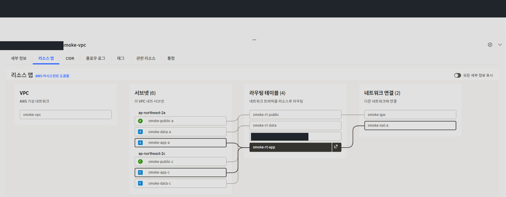

- **목적:** 실제 VPC에서 서브넷·라우팅·외부 연결의 구성을 확인한다.
- **확인 결과:** `ap-northeast-2a`와 `ap-northeast-2c`에 public/app/data 서브넷이 각각 배치돼 총 6개다. 라우팅 테이블은 4개이며, 네트워크 연결 2개는 IGW 1개와 NAT 1개다.
- **제한:** 리소스 맵은 연결 구조의 증빙이다. 경로별 통신 성공이나 EKS 노드의 두 AZ 배치까지 확인한 화면은 아니다.
- **발표 용도:** AWS 네트워크 계층과 두 AZ의 서브넷 분리를 설명하는 대표 구성 자료.

#### 그림 02. 서브넷 6개의 상태

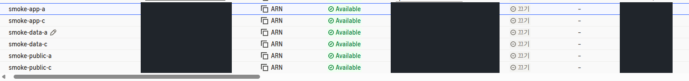

- **목적:** 계획한 서브넷이 실제 목록에 존재하고 어떤 상태인지 확인한다.
- **확인 결과:** public/app/data 각 두 개, 총 6개 서브넷이 `Available`로 표시된다.
- **제한:** 서브넷 상태만으로 인스턴스 배치, 라우트·ACL·SG 전체 적합성이나 서비스 접속을 판정하지 않는다.
- **발표 용도:** VPC 설계와 실제 생성된 서브넷 목록을 대조하는 증빙.

#### 그림 03. 서비스별 보안 그룹 목록

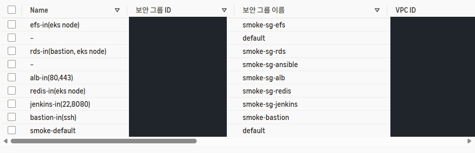

- **목적:** 서비스별 보안 그룹과 Jenkins·Ansible 연계에 사용한 그룹의 존재를 확인한다.
- **확인 결과:** Jenkins·Ansible 및 다른 서비스용 보안 그룹이 목록에 표시된다. 원본 대조에서 Jenkins SG의 ID와 그림 04 SSH 규칙의 소스 SG ID가 일치함을 확인했다. 실제 ID는 공개 사본에서 제거했다.
- **제한:** 그룹의 이름이나 태그는 개별 허용 규칙 전체 또는 해당 서비스의 구축 완료를 입증하지 않는다.
- **발표 용도:** AWS 접근 통제의 서비스별 분리와 Jenkins → Ansible 규칙 대조 근거.

#### 그림 04. Jenkins SG를 소스로 허용한 Ansible SSH 규칙

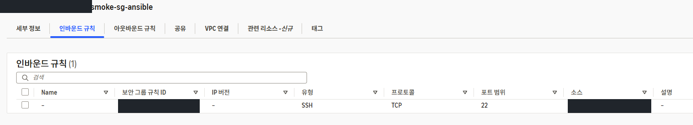

- **목적:** Jenkins에서 Ansible로 들어오는 SSH 접근의 인바운드 규칙을 확인한다.
- **확인 결과:** Ansible 보안 그룹의 규칙 1개가 SSH, TCP, 포트 22이며, 원본 소스 SG는 그림 03의 Jenkins SG와 일치한다.
- **제한:** 이 이미지는 규칙 설정 증빙이다. 실제 SSH 접속 성공은 별도의 팀원 원격 점검 로그를 근거로 판단한다.
- **발표 용도:** CI/CD 원격 실행을 위한 네트워크 허용 설정과 실제 접속 검증을 구분해 설명하는 자료.

#### 그림 05. 아웃바운드 허용 규칙

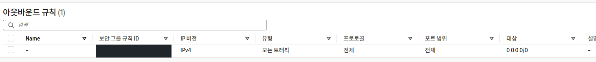

- **목적:** 제공된 아웃바운드 설정 화면의 실제 허용 범위를 확인한다.
- **확인 결과:** IPv4 아웃바운드 규칙 1개가 모든 트래픽, 전체 프로토콜·전체 포트, 대상 `0.0.0.0/0`으로 표시된다.
- **제한:** 화면에 보안 그룹 이름이 없어 어느 SG의 규칙인지 확정하지 않는다. 이 규칙을 Ansible 또는 Jenkins SG의 설정이라고 임의 배정하지 않는다.
- **발표 용도:** 규칙의 허용 범위와 증빙에서 확인할 수 없는 소속 정보를 함께 설명하는 설정 검토 자료.

#### 그림 06. 도메인 등록 실패와 지원 문의 안내

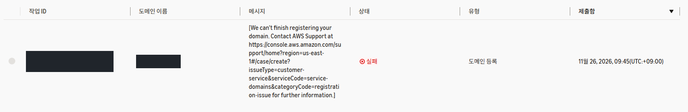

- **목적:** 도메인 등록 과정에서 실제로 발생한 실패와 후속 안내를 기록한다.
- **확인 결과:** 작업 유형은 도메인 등록, 상태는 `실패`이며 AWS Support 문의 안내가 표시된다. 화면의 제출 시각은 2026-11-26 09:45 KST다.
- **제한:** 09:45는 작업 제출 시각이다. 정확한 실패 확정 시각·캡처 시각·내부 실패 원인이나 지원 문의 완료 여부는 이 화면으로 확정하지 않는다.
- **발표 용도:** 외부 서비스 등록 문제와 도메인·ACM 후속 작업을 보류하게 된 이력 설명.

#### 그림 07. 도메인 사용 불가 경고

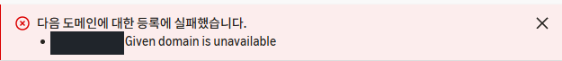

- **목적:** 별도 등록 화면에서 표시된 도메인 사용 불가 경고를 보존한다.
- **확인 결과:** 등록 실패 알림과 `Given domain is unavailable` 문구가 표시된다. 실제 도메인 문자열은 제거했다.
- **제한:** 경고 문구만으로 등록 실패의 상세 원인, 도메인 소유 상태 또는 그림 06과의 인과관계를 확정하지 않는다.
- **발표 용도:** 등록 문제의 실제 사용자 화면과 이후 확인이 필요한 사항을 제시하는 장애 기록.

발표에서는 **기반 구성 → EKS 실행 상태 확인 → CI/CD 연계 준비**의 순서로 설명할 수 있다. 실제 측정하지 않은 배포 시간 단축, 성능 향상, 장애 복구 시간이나 비용 절감률은 수치로 제시하지 않는다.

### 11. 다음 작업 — 우선순위

1. **EKS 실제 구성과 실행 출처 보완:** 사용한 Terraform 원본 및 설정 내보내기를 대조하고, 이미지로 확인한 앱 서브넷과 EKS의 실제 연결 관계 및 노드 AZ 라벨을 확인한다. 실행 호스트·사용자·컨텍스트도 근거가 있는 범위에서 보완한다.
2. **Ansible 역할과 EKS 접근 검증:** Issue #11 및 인계 문서와 대조해 필요한 작업별 권한을 확인하고, `eks:ListClusters` 문제의 현재 상태를 같은 주체로 재확인한다. 불필요한 광범위 권한을 추가하지 않는다.
3. **실제 후보 앱 배포 검증:** 팀원과 배포 대상·이미지·매니페스트를 맞춘 뒤 실제 EKS 실행 결과와 상태 검사 결과를 확보한다. Jenkins #8 테스트 앱 성공을 이 단계의 완료로 대신하지 않는다.
4. **서비스 접속과 전환·복귀 검증:** 초기 HTTP 기준 및 추후 HTTPS 협의를 반영하여 ALB 연결·대상 상태·전환·복귀를 순서대로 확인한다.
5. **DB·첨부 이관 및 운영 검증:** DB 인스턴스와 연결부터 확인하고, 실제 이관 전후 건수·본문·해시를 대조한다. 이후 워커 장애 영향·교체 시간·모니터링·비용을 실측한다.
6. **증빙과 문서 일치 확인:** 보안 처리된 실제 이미지·원본 로그·설정 파일을 연결하고, 진행률과 README의 상태가 증빙 범위를 넘지 않는지 검토한다.

### 12. 출처와 기록 이력

| 출처 | 시각 또는 위치 | 이번 문서에 사용한 내용 |
| --- | --- | --- |
| 도메인 등록 결과 이미지 | 화면의 제출 시각 2026-11-26 09:45 KST · [그림 06 원본의 보안 처리 사본](evidence/1126-domain-registration-failed-masked.png) | 실제 등록 실패 및 AWS Support 안내. 제출·실패 확정·캡처 시각을 구분 |
| 「IAM 권한 준비」 사용자 발언 | 2026-11-26 11:25:29 KST | 기존 AWS 기반 완료 상태, Jenkins EC2 사용, 도메인·ACM 보류 |
| 같은 대화 사용자 발언 | 2026-11-26 12:20:14 KST | RDS DB 서브넷 그룹 생성 완료 보고 |
| 같은 대화의 팀원 인계 보고 | 2026-11-26 16:04:36 KST | Ansible 인계·SSH·도구·STS 및 EKS 조회 권한 문제 |
| 같은 대화 사용자 실행 결과의 회수 요약 | 2026-11-26 16:49:31 KST | Terraform plan의 EKS·노드 그룹 계획 |
| 실제 첨부 `붙여넣은 텍스트(1).txt` | 업로드 2026-11-26 16:51:04 KST · [AWS CLI 원문 발췌](verification/1126-aws-cli-masked.log) | EKS 서비스 지원 버전 조회와 NAT Gateway 1개 `available`. 업로드 시각은 명령 실행 시각이 아님 |
| 같은 대화 사용자 실행 결과의 회수 요약 | 2026-11-26 17:03:39 KST | 적용 후 버전·노드 그룹 상태 |
| 같은 대화 사용자 실행 결과의 회수 요약 | 2026-11-26 17:16:13 KST | 실제 두 kubectl 명령, 노드 및 시스템 Pod 상태 |
| 실제 작업 이미지 7장 | 위 그림 01~07의 실제 파일. 캡처 시각이 없는 이미지는 업로드 시각과 혼동하지 않음 | 두 AZ 서브넷·라우팅·SG·SSH·아웃바운드 설정 및 도메인 실패. 불투명 제거 영역 밖의 원본 픽셀 일치와 메타데이터 제거 검수 |
| 팀원의 실제 원격 점검 로그 | [ansible-remote-check.log](../cicd/verification/ansible-remote-check.log) | 도구 버전, Jenkins → Ansible SSH, local ping, STS 결과 |
| 팀원의 실제 테스트 앱 로그 | [smoke-test-build-8-ansible.log](../cicd/verification/smoke-test-build-8-ansible.log) | Jenkins #8 테스트 앱 성공 및 EKS 수정 없음의 범위 |
| 최신 공통 설계·인계 | [IP·통신 설계](../docs/architecture/ip-plan.md), [Ansible HANDOFF](../cicd/ansible/HANDOFF.md) | Poll SCM, 초기 HTTP·추후 HTTPS 협의, 프라이빗 EKS와 앱 서브넷 계획 |
| 인계 추적 | [Issue #11](https://github.com/CHANYOUNGKANG/Final_4gl_team_smoke/issues/11) | 파트 간 접근·권한·배포 인계의 후속 확인 |

공개 문서에는 키·토큰·비밀번호·인증 파일·실제 관리 주소·AWS 계정 및 리소스 식별자를 포함하지 않는다. 위 링크가 가리키는 자료도 같은 기준으로 검토하며, 검증하지 않은 상태를 완료로 고쳐 적지 않는다.

### 13. 같은 날 병합된 팀 공유 인계 기록 보존

이 문서를 준비하는 동안 [PR #15](https://github.com/CHANYOUNGKANG/Final_4gl_team_smoke/pull/15)가 `main`에 병합됐다. 기존 AWS 작업일지에 추가된 아래 보고를 함께 보존한다. 구성·검증 결과를 독립 재실행한 증거와 구분하며, 최신 상세 인계는 [EKS 구축 보고](infrastructure/eks-handoff-2026-11-26.md)를 따른다. 해당 보고의 서브넷별 워커 배치와 이번에 회수한 노드 출력 요약을 함께 기록하되, 노드별 AZ 원문을 별도 확보한 것으로 표시하지 않는다.

**담당자 보고** — Terraform으로 EKS와 Managed Node Group 구축 완료. 서울 리전, Kubernetes 1.37, 워커 v1.37.1-eks-9adbfea (버전은 보고값), t3.medium 2대, Amazon Linux 2023 x86_64, 두 프라이빗 앱 서브넷, Private Only API. 워커 2/2 Ready, 시스템 Pod 6/6 Running, Restart 0회로 보고됨.

**현재 진행 중** — Ansible 전용 IAM Role의 EKS Access Entry 및 notice namespace / smoke-deployers RBAC 설정. 완료 후 CI/CD 담당자에게 접속·권한 검증 요청 예정.

**후속 작업** — AWS Load Balancer Controller, ALB Blue/Green 대상 그룹 구성. 실제 앱 배포, RDS/EFS 인계, 트래픽 전환과 복구 검증은 별도.

**증빙** — [담당자 보고 및 인계 현황](infrastructure/eks-handoff-2026-11-26.md). Terraform 원본 및 실제 화면·로그 추가 제출 필요. 민감값은 제외했으며 공식 진행률 등록은 원본 근거 확보 후 진행.
