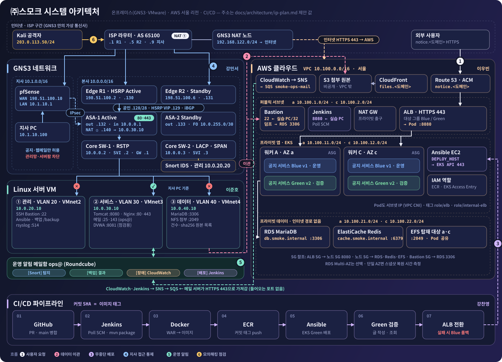
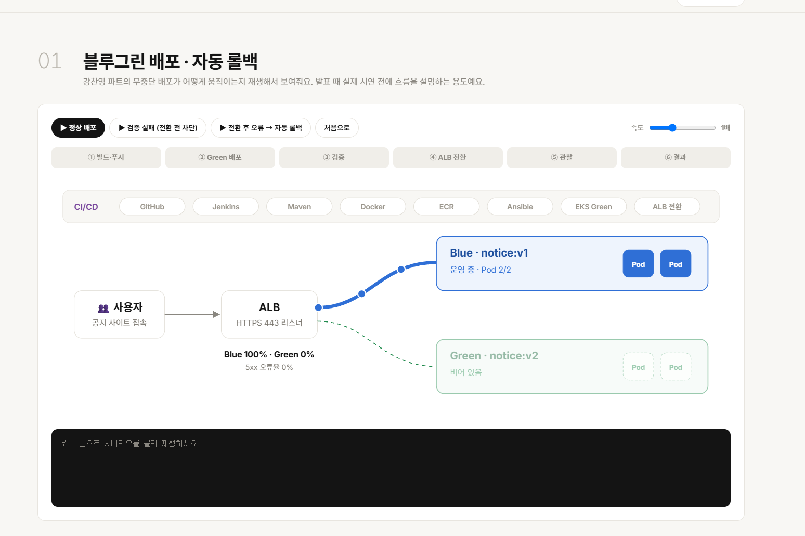

# 시스템 아키텍처

[프로젝트 홈](../../README.md) · [요구사항 명세서](../requirements/README.md) · [**IP 대역 · 통신 허용표**](ip-plan.md) · [전체 구성도 크게 보기](../images/architecture.png)

> 구성도는 팀 아키텍처 대시보드의 그리기 코드를 옮긴 [tools/readme/architecture.js](../../tools/readme/architecture.js)로 생성한다 (IP 표시 모드). 주소가 바뀌면 [ip-plan.md](ip-plan.md)와 스크립트의 값을 함께 고치고 `node tools/readme/architecture.js`를 실행해 SVG를 커밋한다. 이전 설계 화면: [architecture.png](../images/architecture.png)

## 접속과 데이터 이동

| 구간 | 구성과 연결 |
| --- | --- |
| 본사 ↔ 지사 | 지사 pfSense(WAN `198.51.100.10`)와 본사 ASA(outside `.132`) 사이 IPsec VPN, 보호 대역 `10.1.10.0/24 ↔ 10.0.30.0/24`. 지사 업무망에서 공지 서비스는 허용하고 관리망·서버팜 직접 접속은 제한한다. |
| 본사 내부 | Edge R1·R2(HSRP VIP `.129`, eBGP·iBGP) → ASA Active/Standby(Failover `10.0.255.0/30`) → Core SW-1·2(LACP, SVI `.2/.3`, 게이트웨이 `.1`)를 거쳐 관리망 VLAN 20 `10.0.20.0/24`, 서비스망 30, 서버팜 40을 분리한다. 서버 VM은 각 VLAN의 `.10`, Snort 관리 NIC는 `10.0.20.20`. |
| 외부 공지 | Route 53에서 서비스 주소를 해석하고 ALB(퍼블릭 `10.100.1·2.0/24`)가 HTTPS 요청을 현재 운영 대상 그룹으로 보낸다. EKS 워커는 프라이빗 앱 `10.100.11·12.0/24` 두 가용 영역에 분산한다. |
| 첨부파일 | 원본 파일을 S3에 동기화한 후 해시를 대조한다. 다운로드는 CloudFront로 제공하고 S3 원본 직접 접근을 제한한다. |
| 데이터와 상태 | Linux MariaDB 덤프를 Bastion EC2 경유로 RDS에 복원한다. RDS·Redis·EFS는 인터넷 경로가 없는 데이터 서브넷 `10.100.21·22.0/24`에 두고 `db.smoke.internal`·`cache.smoke.internal` 이름으로 붙는다. |
| 알림 | Snort 탐지와 서버 백업 결과를 운영 메일로 보낸다. Jenkins 배포 결과와 CloudWatch 경보는 SNS·SQS를 거쳐 메일 서버가 수신하도록 설계한다. |
| CI/CD 위치 | Jenkins는 퍼블릭 서브넷, SG는 실습 PC 공인 IP/32만 허용 → GitHub Webhook 대신 **Poll SCM**이 기본. Ansible EC2는 프라이빗 앱 서브넷에서 EKS API·ECR에 IAM 역할 + Access Entry로 접근한다. |

## Blue에서 Green으로

| 시점 | 검사와 동작 |
| --- | --- |
| 배포 전 | Blue가 운영 트래픽을 받는다. 커밋 태그로 ECR 이미지를 식별하고 Ansible이 Green에 배포한다. |
| 전환 전 검사 | Green 전용 경로에서 글 작성·조회를 확인한다. 실패하면 Blue가 계속 요청을 받는다. |
| 전환 후 검사 | 운영 주소의 응답 버전과 공지 조회를 확인한다. 실패하면 Jenkins가 ALB 복귀 절차를 호출한다. |
| 기록 | 전환 전부터 복귀 후까지의 요청 수·실패 수·버전·시각을 같은 실행 기록에 남긴다. |

**ALB 협업 지점** · 수행계획서에는 이우빈이 전환·복귀 스크립트를 맡고, 체크리스트에는 강찬영의 파이프라인 작업에도 이 항목이 있다. AWS 대상 그룹·전환 스크립트는 이우빈, Jenkins 호출·판정·자동 복귀 검증은 강찬영을 기준으로 함께 확인한다.
