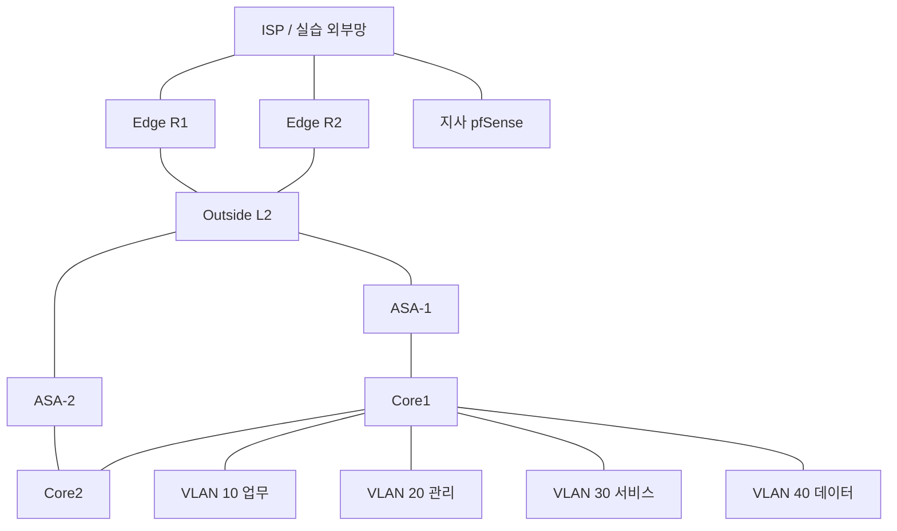

# DAY 1 토폴로지 및 주소 대조 · 2026-11-26

## 논리 구성 (설계 개요, 전체 경로 검증 전)

ASA와 Core 사이의 transit은 VLAN 901. Core1 구성 적용 확인, Core2 및 ASA 절체는 검증 전. 그림은 논리 설계이며 실제 포트 배선 전체의 증빙이 아니다.

| VLAN | 용도 | DAY1 상태 |
| --- | --- | --- |
| 10 | 업무 | Core1 SVI up/up, HSRP Active |
| 20 | 관리 | SVI up/up, HSRP Active; 주소 중복 조사 중 |
| 30 | 서비스 | SVI up/up, HSRP Active |
| 40 | 데이터 | SVI up/up, HSRP Active |
| 901 | ASA–Core transit | SVI up/up, HSRP 최종 상태 재확인 |

## 서버 연동
- 관리: Bastion/백업/로그, 서비스: Nginx/Tomcat/메일, 데이터: NFS/MariaDB.
- 현재 GNS3 설계 화면은 공통 [IP 계획](../../docs/architecture/ip-plan.md)과 다른 대역 및 게이트웨이 체계를 사용한다. 실제 서비스·DB VM 설정은 서버 담당과 대조 전이므로 공통 계획은 수정하지 않는다. [이슈 #11](https://github.com/CHANYOUNGKANG/Final_4gl_team_smoke/issues/11) 참조.
- 관리망 접근 제한, 서비스/데이터 통신 허용 방향은 설계 목표이며 ACL 시험 완료가 아니다.
