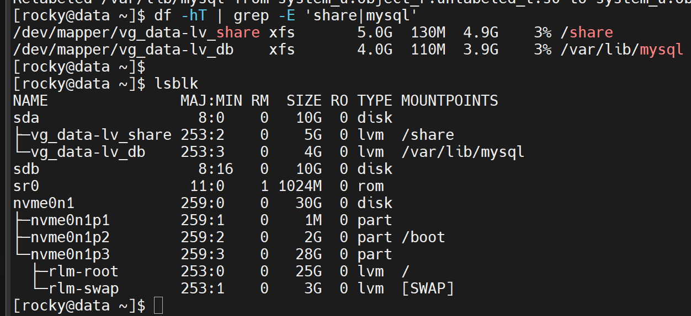
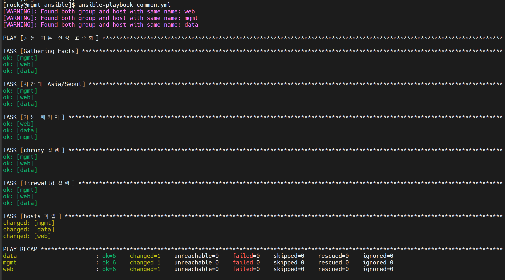
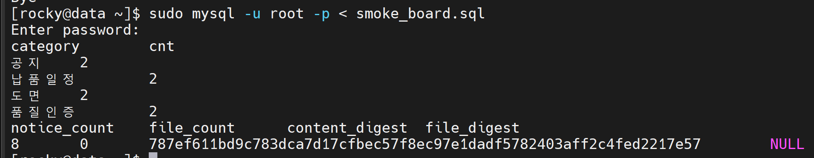
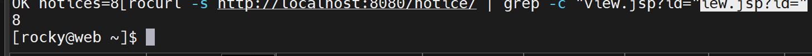

# Linux 서버·운영 메일


**담당자 메일**　[dlwnsgh7789@gmail.com](mailto:dlwnsgh7789@gmail.com)　·　[프로젝트 홈](../README.md)　·　[요구사항](../docs/requirements/README.md)

기존 서버를 정비하고 AWS 이관의 비교 기준이 될 원본 목록과 운영 알림 수신 체계를 준비한다.

| 작업 위치 | 올릴 내용 |
| --- | --- |
| [configuration/](configuration/) | Linux 계정·SSH·로그 및 NFS 구성 · [Ansible](configuration/ansible/) · [web](configuration/web/) · [data](configuration/data/) · [VMware](configuration/vmware/) |
| [db/](db/) | 공지·자료실 DB `smoke_board` 스키마와 이관 대조 뷰 |
| [onprem-notice-jsp/](onprem-notice-jsp/) | 온프레미스 Tomcat 에 실제 배포한 임시 JSP 공지 앱 (팀 표준 앱은 [app/](../app/)) |
| [backup/](backup/) | 백업 절차, 게시글 건수와 첨부파일 해시 대조 양식 |
| [mail/](mail/) | Postfix·Roundcube 운영 절차와 알림 수신 결과 |
| [WORKLOG.md](WORKLOG.md) · [verification/](verification/) · [evidence/](evidence/) | 작업일지 · 검증 기록 · 가린 캡처 |

## 현재 구축 현황 (11/27)

| 서버 | 구축 완료 (실행 확인) | 다음 |
| --- | --- | --- |
| mgmt | Ansible 3대 관리 · SSH 정책 · 중앙 로그 수신 · 백업 사본 03:00 · Prometheus/Grafana 3/3 UP | SQS 알림 수신 · Grafana 장애 알림 |
| web | Nginx → Tomcat 회사 사이트·공지 자료실(팀 표준 앱) · NFS 첨부 · Postfix/Dovecot/Roundcube · 문의 → 메일 | VPN 후 AWS 직접 SMTP |
| data | LVM(첨부 5G·DB 4G·예비 10G) · NFS · MariaDB `boarddb` · 백업 02:00 + 결과 메일 · 복구 시험 | RDS 이관 대조 |

```
브라우저 → web: Nginx(80) ─ / ─────→ Tomcat(127.0.0.1:8080) 회사 사이트·공지
                         └ /webmail → Roundcube → Dovecot·Postfix (smoke.local)
                                         ├─ JDBC 3306 → data: MariaDB boarddb
                                         └─ NFS 2049  → data: /share/attach (LVM)
mgmt: Ansible · rsyslog(514 수신) · 백업 복제 · Prometheus(9100 수집) · Grafana
운영 알림 → smoke@smoke.local (문의 ✅ · 백업 ✅ · 배포/AWS/탐지 ⏳)
```

상세: [11/27 확인 기록](verification/1127-ops-check.md) · [백업](backup/README.md) · [메일·알림](mail/README.md)

**대표 결과** — 상세 설명은 [작업일지](WORKLOG.md)

| LVM 저장소 분리 | Ansible 3대 표준화 |
| --- | --- |
|  |  |
| **DB 이관 기준 (8건)** | **Tomcat → DB 연결** |
|  |  |

서버 주소 대역은 네트워크 담당 확정안을 따르며, 공통 IP 설계표와의 차이는 [이슈 #11](https://github.com/CHANYOUNGKANG/Final_4gl_team_smoke/issues/11)에서 확정한다. 공개 자료의 관리 주소는 `MGMT_HOST`·`WEB_HOST`·`DATA_HOST` 로 표기한다.

## 작업 체크리스트

- [ ] [공지 앱 인계표](../app/README.md)에 소스 위치·실행 버전·조회 경로를 적어 강찬영에게 전달한다.
- [x] 계정·SSH·로그를 정비하고 백업 시각, 원본 게시글 건수·대표 본문·첨부파일 해시를 [백업 폴더](backup/)에 정리한다.
- [ ] 최종 이관 전 쓰기 중지 시점을 맞추고 이우빈과 원본·대상 데이터를 대조한다.
- [ ] 보안 탐지·백업·장애·배포 알림이 운영 메일함에 도착하는지 확인하고 수신 기록을 [메일 폴더](mail/)에 남긴다.

[첫날 작업표와 파트 간 인계](../docs/delivery/README.md#첫날-작업표) · [시연 결과 기록](../docs/delivery/README.md#결과-기록표) · [작업 양식](../docs/templates/README.md) · [작업 이슈 열기](https://github.com/CHANYOUNGKANG/Final_4gl_team_smoke/issues/new?template=team-task.yml) · [인계 요청](https://github.com/CHANYOUNGKANG/Final_4gl_team_smoke/issues/new?template=handoff.yml)

## 팀 연동

이우빈에게 이관 기준 건수와 해시 목록을, 강찬영에게 앱 경로·Java/Tomcat 버전과 공지 검증 경로를 전달한다.
