# Linux 서버 작업일지 · 이준호

최신 항목이 맨 위. 항목마다 **확인한 결과(직접 실행·관찰한 것만) · 막힌 부분 · 다음 작업 · 증빙**을 남긴다. 캡처는 민감값(관리 주소·MAC·키)을 가린 사본만 [evidence/](evidence/)에 둔다. 🎤 표시는 발표 후보.

## 이정표 현황 (11/27 기준)

| 이정표 | 내용 | 구현 | 실행 확인 | 근거 |
| --- | --- | :---: | :---: | --- |
| SRV1 | SSH·로그 관리 | ✅ sshd 정책·rsyslog 중앙 수집 | ✅ 3대 `sshd -T`, root 접속 차단, mgmt 중앙 로그 | [확인 기록 §2·§3](verification/1127-ops-check.md#2-ssh-정책-srv1) |
| SRV2 | DB·파일 백업과 원본 목록 | ✅ [backup.yml](configuration/ansible/backup.yml) | ✅ 덤프·해시 목록·mgmt 복제·복구 시험 | [확인 기록 §6](verification/1127-ops-check.md#6-백업복구-srv2) |
| SRV3 | 공지 앱 빌드·실행 정보 | ✅ app/ (팀 표준 앱, PR #21) | ✅ 온프레미스 Tomcat 실행 | [검증 기록 §6](verification/1126-onprem-service-check.md#6-공지-앱-tomcat--mariadb-동작) |
| SRV4 | 운영 알림 메일 | ✅ Postfix·Dovecot·Roundcube | 🟡 문의·백업 알림 수신. 배포·AWS·탐지 알림은 대기 | [확인 기록 §7·§8](verification/1127-ops-check.md#7-사내-메일-srv4) |

---

## 2026-11-27 (금) · SSH·중앙 로그·백업·메일·모니터링 구축과 운영 알림

**실제로 확인한 결과** (상세: [확인 기록](verification/1127-ops-check.md), 캡처 30장: [evidence/2026-11-27](evidence/2026-11-27/))
- SSH: Ansible 로 3대 `PermitRootLogin no`·`AllowUsers rocky`·`MaxAuthTries 3` 적용, `sshd -T` 3대 동일. root 원격 접속 `Permission denied` 와 실패 기록이 mgmt 중앙 로그에 남음
- 중앙 로그: web·data → mgmt TCP 514, `/var/log/remote/<호스트>/` 에 시험 로그 각 1줄
- 백업: data 덤프·기준값·첨부 해시·첨부 압축·SHA256SUMS 생성, mgmt 03:00 복제, 임시 DB 복구 시험 건수·해시 일치
- 백업 결과 메일: 래퍼를 Ansible 로 배포(`changed=2 failed=0`), 직접 실행 `rc=0`, smoke@ 에 `[백업] data 성공` 수신 (16:20)
- 메일: Postfix 배달 `status=sent`, Dovecot IMAP, Roundcube 로그인·user1→user2 송수신, 홈페이지 문의 #7 → smoke@ 알림 수신
- 모니터링: node_exporter 3대 → Prometheus `3 / 3 up` → Grafana 대시보드 (web, data 디스크별)

**막힌 부분과 해결**
- `PermitRootLogin` 이 yes 로 남음 → 설치 시 생긴 `01-permitrootlogin.conf` 가 먼저 읽힘 (`sshd -T` 로 확인) → 제거
- sudo rsync 호스트 키 확인 실패 → root known_hosts 를 찾는 것이 원인 → `UserKnownHostsFile` 지정
- Roundcube 로그인 실패 → Dovecot 이 `user@domain` 을 시스템 계정으로 못 찾음 → `auth_username_format = %Ln`
- 재부팅 후 web 부팅 지연 → data 보다 먼저 켜져 NFS 대기 → fstab `_netdev,nofail`
- 백업 래퍼 첫 배포 실패 → mgmt 에 `templates/` 파일이 없었음 → 생성 후 재실행 성공

**결정**
- 운영 알림 메일함은 `smoke@smoke.local` 하나로 통일 (구성도의 `ops@` 표기 → smoke@)
- AWS 알림(배포·롤백·CloudWatch)은 VPN 전까지 SNS → SQS → mgmt 수신 → smoke@ ([mail/](mail/README.md)). 강찬영 PR #23 은 SNS 발행으로 수정, SQS `RawMessageDelivery=false`

**다음 작업**
- 이우빈: SNS 토픽·SQS 대기열·온프레미스 수신 전용 최소 권한 키 (값은 개인 메시지로)
- 이준호: mgmt SQS 수신 스크립트·플레이북, Grafana 장애 알림 규칙, 백업 실패 메일 시험, sshd·rsyslog·monitoring 플레이북 원본을 mgmt 에서 옮겨 올리기
- 이우빈·이준호: RDS 이관 후 `v_migration_check` 대조표
- 강민서: VPN 연결 시 web 메일 서버 경로 (Jenkins 직접 SMTP 대안)

**증빙** — [evidence/2026-11-27](evidence/2026-11-27/) · [확인 기록](verification/1127-ops-check.md) · PR #21 (팀 표준 앱) · CI/CD PR #23 (알림)

---

## 2026-11-27 (금) · 팀 표준 앱을 온프레미스 검증 앱으로 교체 (app/ PR)

**결정** — 강찬영과 합의: 온프레미스에서 운영·검증한 회사 사이트 + 공지·자료실(JSP, `boarddb`)을 팀 표준으로 삼고 그대로 이관한다. 이전 레퍼런스 앱(Spring Boot, `smoke_board`)은 `app-reference/` 로 보존.

**온프레미스에서 실제로 확인한 결과 (이 앱 기준)**
- web: Tomcat 10.1 에 ROOT.war 배포, Nginx(80) → Tomcat(127.0.0.1:8080), `health.jsp?db=1` 응답 `{"status":"UP","db":"UP",…}`
- 공지 작성 + 첨부 업로드 → DB `board_file.sha256` 과 NFS 실제 파일 `sha256sum` 일치 (1건)
- 백업 복구 테스트: 덤프를 임시 DB 에 복원해 게시글·첨부·문의 건수와 본문 해시 앞 16자리가 원본과 같음, 첨부 해시 OK
- 인계 수집(14:04): 게시글 14 · 첨부 1 · 문의 6, `v_migration_check` 본문·첨부 해시 기록 (값은 인계 자료에만, 원본 데이터는 저장소에 올리지 않음)

**이번 PR 에서 바꾼 것**
- CI/CD 규격 추가: `/health`(status·db·storage·app·version·color·commit), `/version`, `/notices`, 검증 API `POST 201 → GET 200 → DELETE 204 → 404`, `X-Check-Token`, 검증 글 `is_check=1` 은 공개 목록·상세(404)·대조 뷰에서 제외
- DB 설정을 `DB_HOST`/`DB_PASSWORD` 방식으로도 받고, 설정이 없으면 H2 메모리 DB 로 기동 (CI 격리 검증)
- 소스 기본값에 있던 실제 DB 주소·비밀번호 제거, 빌드 결과 `target/notice.war`, Java 17
- `app/sql/schema.sql` 에 `is_check`·`sha256`·`v_migration_check`(검증 글 제외) 포함, 예시 데이터에서 실제 파일 없는 첨부 행 제거
- PR 검사(app-build)를 Tomcat 10.1 컨테이너 기동 방식으로 변경

**확인 범위 (이 세션)**
- `SiteUtil` 단위 테스트와 같은 내용을 javac 로 직접 돌려 전부 통과, JSP 스크립틀릿 11개를 서블릿 API 스텁에 대고 컴파일 오류 없음
- Maven 저장소 접속이 막힌 환경이라 `mvn package`·Tomcat 기동 검사는 PR 검사(app-build)와 Jenkins 에서 확인 필요

**다음 작업**
- 강찬영: PR 리뷰, Jenkins 빌드·검증, Docker 이미지 H2/환경 변수 정리
- 이우빈: RDS 스키마를 `app/sql/schema.sql`(boarddb) 기준으로 적용
- 이준호: 머지된 WAR 로 온프레미스 교체 확인, 인계 자료 재전달, 이관 후 대조표 작성

## 2026-11-26 (목) · 온프레미스 서버 3대 구축 · DB·NFS·Tomcat 3-Tier 연결

**작업 목적** — 고객사(해든정밀) 공지·자료실의 온프레미스 원본 환경을 만든다. 이 환경의 게시글 건수·본문 해시·첨부 해시가 AWS 이관의 비교 기준이 된다 (NFR-03).

**구축 환경**

| 서버 | 역할 | VMware 네트워크 | vCPU·RAM | 디스크 |
| --- | --- | --- | --- | --- |
| mgmt | 관리·Ansible·(예정) 로그·모니터링 | VMnet2 (VLAN 20) + 임시 NAT | 2 · 4GB (그림 02) | NVMe 30GB(OS) + SCSI 20GB |
| web | Nginx·Tomcat·공지 앱·(예정) 메일 | VMnet3 (VLAN 30) + 임시 NAT | 캡처 없음 | NVMe 30GB(OS) |
| data | MariaDB·NFS·LVM | VMnet4 (VLAN 40) + 임시 NAT | 캡처 없음 | NVMe 30GB(OS) + SCSI 10GB ×2 (lsblk 확인) |

- OS: Rocky Linux 10.3 minimal (설치 화면 기준) · 템플릿 1대 설치 → `/etc/machine-id` 비우고 SSH 호스트 키 삭제 → 스냅샷 → 전체 복제 3대
- 서버 주소는 네트워크 담당 확정안(VLAN 20/30/40, 게이트웨이 `.254`)을 따랐다. `docs/architecture/ip-plan.md`와 다른 점은 [이슈 #11](https://github.com/CHANYOUNGKANG/Final_4gl_team_smoke/issues/11)에서 확정 대기. GNS3 연동 전이라 패키지 설치·서버 간 통신은 VMware NAT 임시 어댑터로 했다.
- 확인한 버전: OpenJDK 21.0.13.1 (Red_Hat-21.0.13.1.2-1) · Tomcat 10.1.61 · MariaDB Connector/J 3.3.2 · MariaDB 는 dnf 기본 패키지(버전 출력 캡처 없음 → 다음에 `SELECT VERSION()` 기록)

### 1) VM 생성·복제

**그림 01. OS 디스크 30GB (NVMe)**

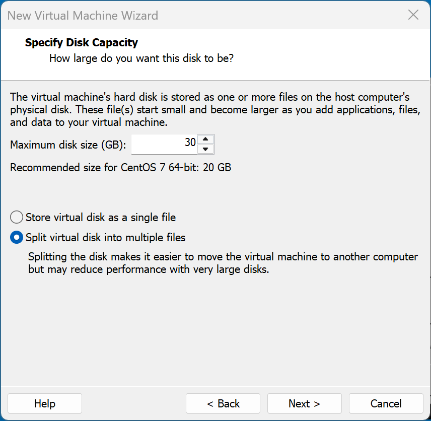

- 확인할 부분: 최대 디스크 30GB. OS 디스크는 NVMe, 데이터 디스크는 나중에 SCSI 로 추가해 분리했다.

**그림 02. 관리 서버 VM 설정 — VMnet2 (Host-only)**

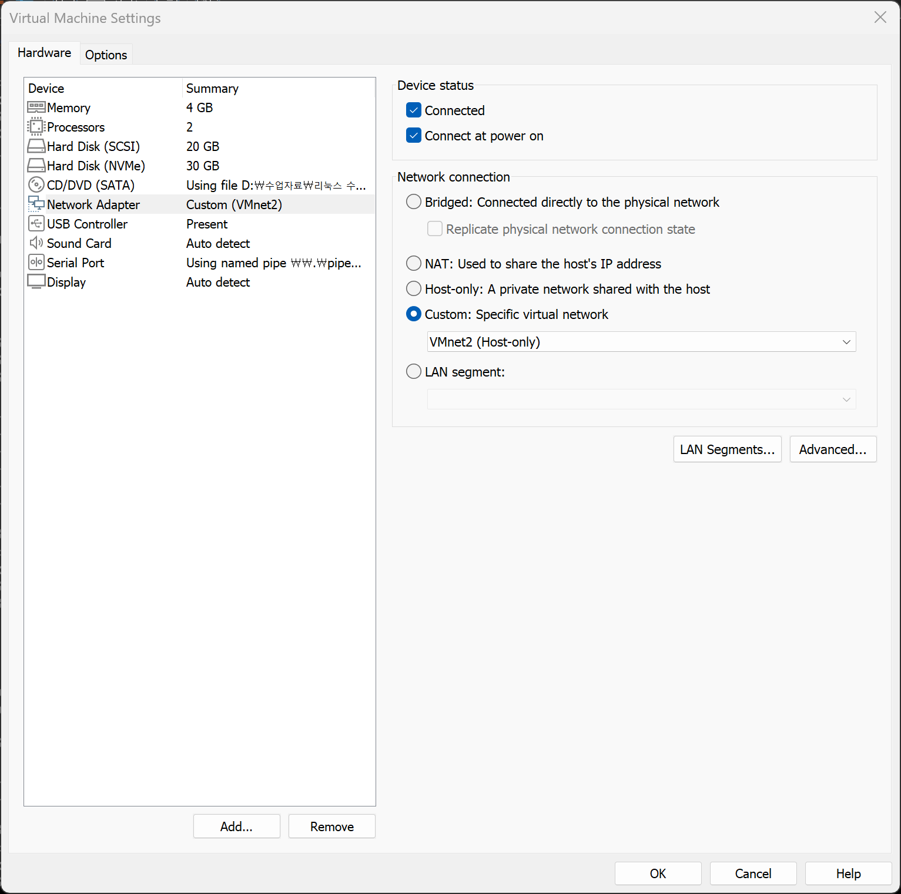

- 확인할 부분: Network Adapter = Custom VMnet2, Hard Disk NVMe 30GB + SCSI 20GB, Memory 4GB.

### 2) 기본 설정 · SSH 키 · Ansible

```bash
# 3대: 연결 프로필 재생성 (복제본에 템플릿의 ens160·"유선 연결 1" 프로필이 남아 있었음)
sudo nmcli con delete <UUID>                    # 깨진 한글 이름은 UUID 로 지움
sudo nmcli con add type ethernet ifname <장치> con-name <장치> ipv4.method manual \
  ipv4.addresses <서버주소>/24 ipv4.gateway <게이트웨이 .254> ipv4.dns 8.8.8.8 \
  ipv6.method disabled connection.autoconnect yes
sudo nmcli con add type ethernet ifname <NAT장치> con-name nat ipv4.method auto ipv4.route-metric 50
sudo timedatectl set-timezone Asia/Seoul
sudo dnf -y update && sudo dnf -y install epel-release chrony vim bash-completion tar rsync wget net-tools bind-utils lsof
sudo systemctl enable --now chronyd firewalld

# mgmt (rocky)
ssh-keygen -t ed25519 -C "rocky@mgmt"
ssh-copy-id rocky@WEB_HOST && ssh-copy-id rocky@DATA_HOST
sudo dnf -y install ansible-core
cd ~/ansible && ansible all -m ping && ansible-playbook common.yml
```
설정 파일: [ansible.cfg](configuration/ansible/ansible.cfg) · [inventory.example.ini](configuration/ansible/inventory.example.ini) · [common.yml](configuration/ansible/common.yml)

**그림 11. 🎤 Ansible 공통 설정 플레이북 — 3대 failed=0**

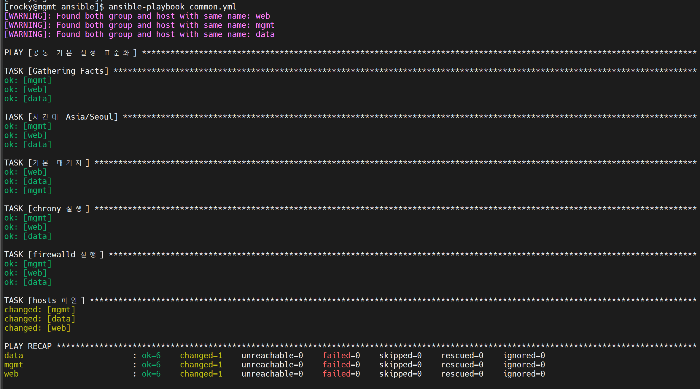

- 확인할 부분: PLAY RECAP 에서 data·mgmt·web 모두 ok=6, failed=0. 손으로 한 기본 설정을 코드로 표준화(멘토 의견 반영).
- 발표 활용: “서버 표준화 자동화” 장

### 3) data 서버 — LVM · NFS · MariaDB

```bash
sudo pvcreate /dev/sda && sudo vgcreate vg_data /dev/sda
sudo lvcreate -n lv_share -L 5G vg_data && sudo lvcreate -n lv_db -L 4G vg_data   # 1G 여유
sudo mkfs.xfs /dev/vg_data/lv_share && sudo mkfs.xfs /dev/vg_data/lv_db
# fstab 2줄 추가 → mount -a → restorecon -Rv /share /var/lib/mysql
sudo dnf -y install nfs-utils
sudo groupadd -g 1500 smokefile && sudo useradd -u 1500 -g 1500 -s /sbin/nologin -M smokefile
sudo mkdir -p /share/attach && sudo chown 1500:1500 /share/attach
sudo systemctl enable --now nfs-server && sudo exportfs -rv
sudo firewall-cmd --permanent --add-service={nfs,mysql} && sudo firewall-cmd --reload
sudo dnf -y install mariadb-server && sudo systemctl enable --now mariadb
sudo mysql_secure_installation            # unix_socket 전환 n, root 비밀번호 설정, 익명·원격 root·test DB 제거
sudo mysql -u root -p < smoke_board.sql   # ../db/smoke_board.sql (비밀번호 자리는 실행 때만 바꿈)
```
설정 파일: [fstab.example](configuration/data/fstab.example) · [exports.example](configuration/data/exports.example) · [mariadb-smoke.cnf](configuration/data/mariadb-smoke.cnf) · DB [smoke_board.sql](db/smoke_board.sql)

**그림 12. 🎤 데이터 서버 저장소 — LVM 으로 첨부·DB 볼륨 분리**

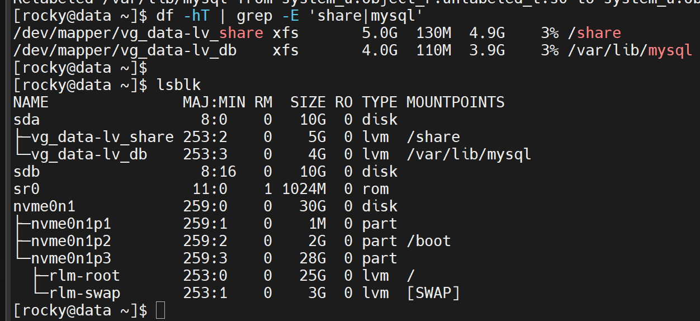

- 확인할 부분: sda 10G → lv_share 5G(`/share`, NFS 첨부) · lv_db 4G(`/var/lib/mysql`). sdb 10G 는 비워 둠 → 디스크 부족 시 `vgextend` + `lvextend -r` 무중단 확장 시연용.

**그림 13. 🎤 MariaDB `smoke_board` — 분류별 샘플 8건, 이관 대조 뷰**

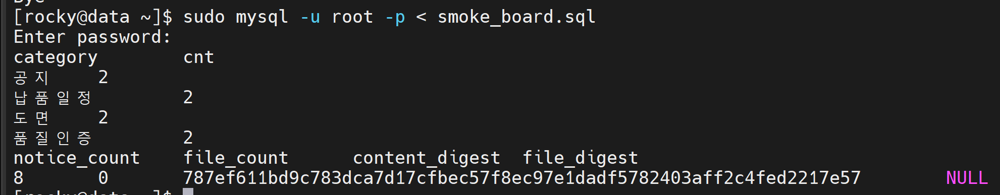

- 확인할 부분: 분류 4종 각 2건, `v_migration_check` notice_count=8, content_digest 값 생성, file_digest NULL(첨부 0건).

### 4) web 서버 — Java · Tomcat · NFS 마운트 · 공지 앱

```bash
sudo dnf -y install java-21-openjdk-devel
sudo useradd -r -m -d /opt/tomcat -s /sbin/nologin tomcat
curl -O https://archive.apache.org/dist/tomcat/tomcat-10/v10.1.61/bin/apache-tomcat-10.1.61.tar.gz
sudo tar xzf apache-tomcat-10.1.61.tar.gz -C /opt/tomcat --strip-components=1
curl -O https://repo1.maven.org/maven2/org/mariadb/jdbc/mariadb-java-client/3.3.2/mariadb-java-client-3.3.2.jar
sudo mv mariadb-java-client-3.3.2.jar /opt/tomcat/lib/ && sudo chown -R tomcat:tomcat /opt/tomcat
# /etc/tomcat-smoke.env (600) · /etc/systemd/system/tomcat.service → systemctl enable --now tomcat
sudo dnf -y install nfs-utils && sudo mkdir -p /var/smoke/attach    # fstab 1줄 → mount -a
sudo cp ~/notice.war /opt/tomcat/webapps/ && sudo chown tomcat:tomcat /opt/tomcat/webapps/notice.war
sudo dnf -y install nginx                 # 설치만 완료, 프록시 설정 적용은 다음 작업
```
설정 파일: [tomcat.service](configuration/web/tomcat.service) · [tomcat-smoke.env.example](configuration/web/tomcat-smoke.env.example) · [fstab.example](configuration/web/fstab.example) · [nginx-smoke.conf](configuration/web/nginx-smoke.conf) · 앱 [onprem-notice-jsp/](onprem-notice-jsp/)

**그림 14. Java 21 · Tomcat 10.1.61 · JDBC 드라이버 설치**

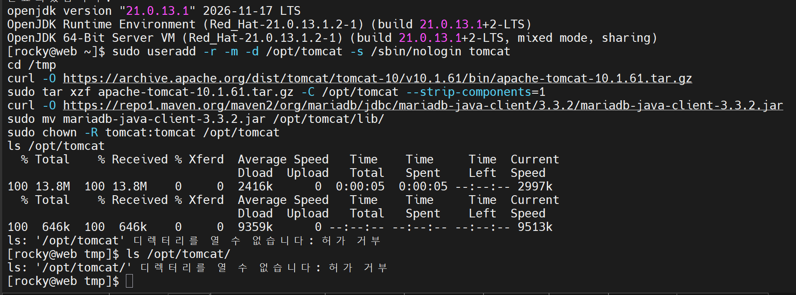

- 확인할 부분: `openjdk version "21.0.13.1"`, Tomcat·JDBC 다운로드 100%. 마지막 `ls` 거부는 `/opt/tomcat` 이 tomcat 전용 홈(700)이라서 정상 (`sudo ls` 로 확인).

**그림 15. 🎤 web 서버에 data 서버 첨부 폴더 NFS 마운트**

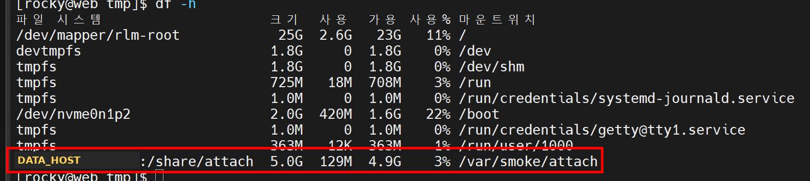

- 확인할 부분: `DATA_HOST:/share/attach 5.0G → /var/smoke/attach`. 주소는 가린 사본.

**그림 19. 🎤 공지 앱 상태 확인 — Tomcat → MariaDB 연결**

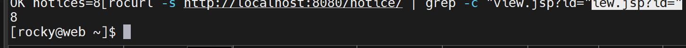

- 확인할 부분: `health.jsp` → `OK notices=8`, 목록 HTML 의 글 링크 8개. 웹 → DB 3-Tier 동작 근거 (SRV3 실행 근거).
- 원본 캡처 윗줄에 키 값이 보여 잘라 낸 사본.

### 5) 오류와 해결 (트러블슈팅)

| # | 증상 | 원인 | 해결 | 그림 |
| --- | --- | --- | --- | --- |
| T1 | 복제 중 “A file with that name already exists” | 복제본을 템플릿과 같은 폴더에 만듦 | VM 마다 폴더 분리(smoke-mgmt/web/data) | 04 |
| T2 | 복제본 실행 후 원본이 “scoreboard file establishment failed” | 같은 폴더의 `.scoreboard`·`.lck` 잠금 충돌 | 폴더 분리, 잠금 파일 정리 | 05 |
| T3 | 🎤 디스크·NAT 어댑터 추가 후 설치 화면 / PXE 부팅 | BIOS 부팅 순서가 새 SCSI 디스크·랜카드로 바뀜 | ISO 자동 연결 해제 + NVMe 우선 부팅 지정(BIOS 화면 또는 [.vmx](configuration/vmware/vmx-boot-order.txt)) 후 정상 부팅 | 03 · 03b |
| T4 | `nmcli` “unknown connection 'ens36'” | 복제본에 템플릿 프로필(ens160·“유선 연결 1”)이 남음 | UUID 로 삭제 후 실제 장치 이름으로 재생성 | 06 |
| T5 | 🎤 ping 응답 중복·지연 증가, SSH 끊김 | GNS3 에 VM 노드와 VMnet Cloud 를 동시에 연결 → L2 루프 | VM 노드 삭제, VLAN 마다 Cloud(VMnet + UDP 터널) + 허브 1개 | 07 · 08 · 09 |
| T6 | 관리 VLAN 만 SSH 불가 | 실습 PC VMnet 어댑터 주소가 상대 장비 주소(.1)와 충돌 | 실습 PC 어댑터를 `.200` 으로 옮기도록 조치 (적용 결과 캡처 없음) | — |
| T7 | `community.general.timezone` 모듈 없음 | ansible-core 기본에 미포함 | `command: timedatectl` 로 대체 | 10 |
| T8 | DB 접속 115 → 1045 → Tomcat `host=DATA_NAT` | 방화벽 미개방 → 계정 비밀번호 불일치 → env 자리표시자 | mysql 서비스 허용 → `ALTER USER` → env 수정·재시작 | 16 · 17 · 18 |

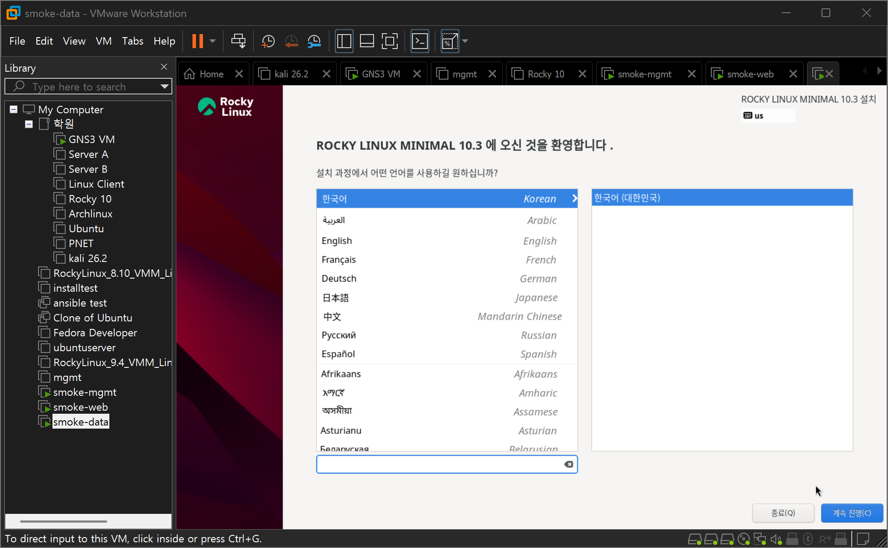
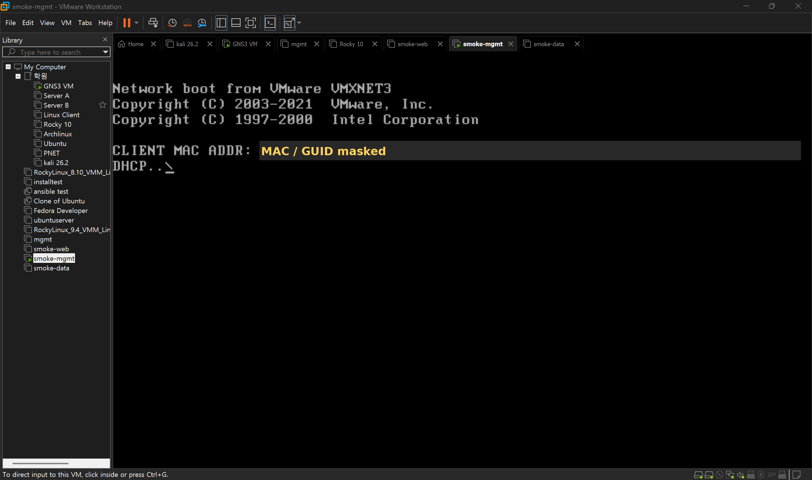
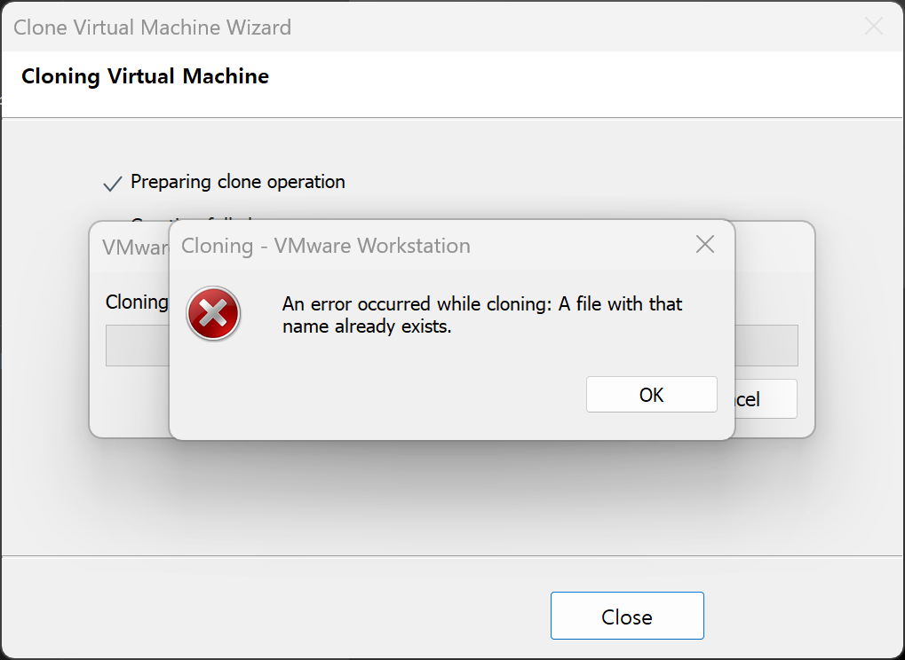
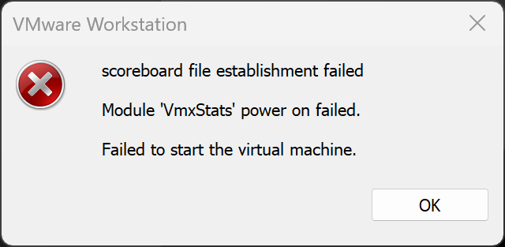
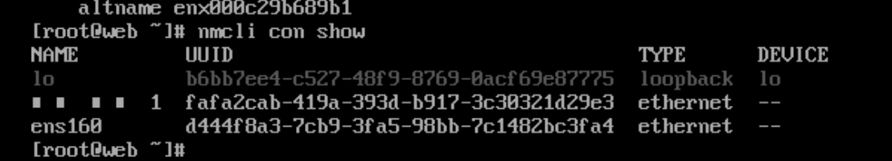
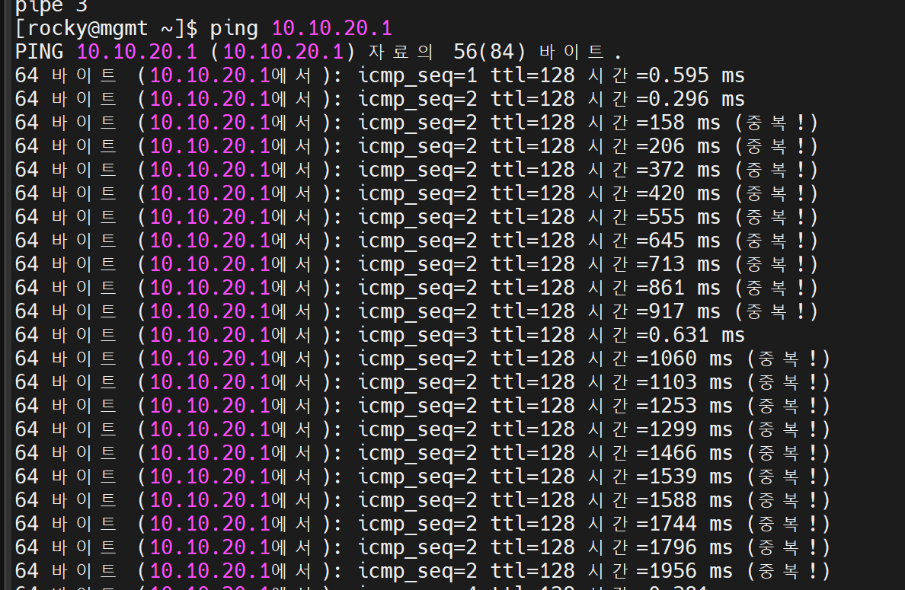
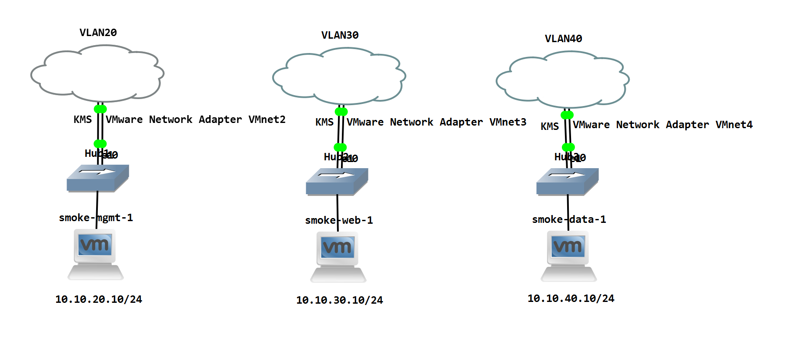
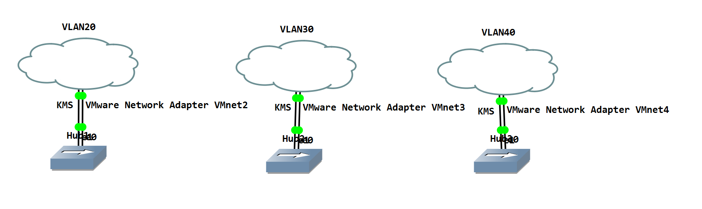
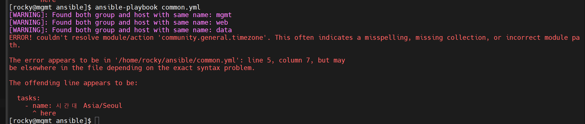
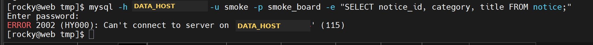
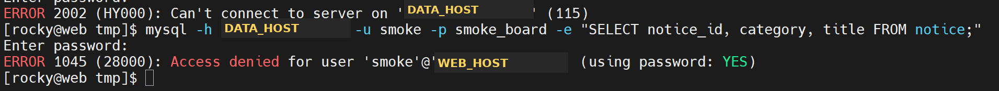
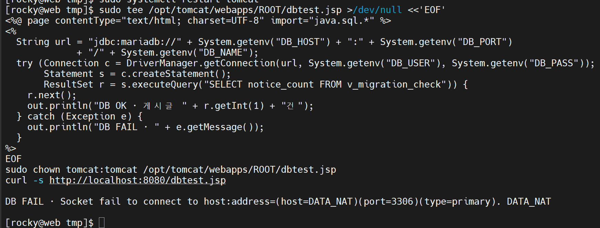

**막힌 부분 · 미해결**
- GNS3 UDP 터널 연동 후 게이트웨이(`.254`) 응답 미확인 → 강민서 측 SVI·HSRP·트렁크(Po1) 확인 필요. VLAN 간 통신은 아직 없음.
- 온프레미스 앱이 팀 표준 [app/](../app/)(Spring Boot, Java 17)이 아니라 임시 JSP 앱이다. 이관 기준을 같게 하려면 온프레미스도 app/ WAR 로 맞추는 것이 좋다 → 이슈 #11 에서 결정.
- MariaDB 문자셋 정렬(`utf8mb4_unicode_ci`) 서버 설정 적용 여부와 `SELECT VERSION()` 결과 미기록.

**다음 작업**
1. Nginx 프록시 적용 → Tomcat 8080 을 127.0.0.1 전용으로, 방화벽 http 만 허용 → 브라우저에서 글쓰기·첨부·다운로드 확인
2. 첨부 업로드 후 `v_migration_check` file_count·file_digest 기록 (SRV2·AWS3 기준값)
3. mgmt: sshd 정책(`PermitRootLogin no`, 키 인증) · rsyslog 중앙 수집 (SRV1)
4. mysqldump + 첨부 sha256 목록 백업 스크립트 (SRV2) → 이우빈에게 이관 기준 전달
5. 메일 서버 (SRV4) · 모니터링 (Prometheus·Grafana)

**증빙** — [검증 기록](verification/1126-onprem-service-check.md) · [evidence/2026-11-26](evidence/2026-11-26/) (가린 사본 20장) · 이슈 #11
